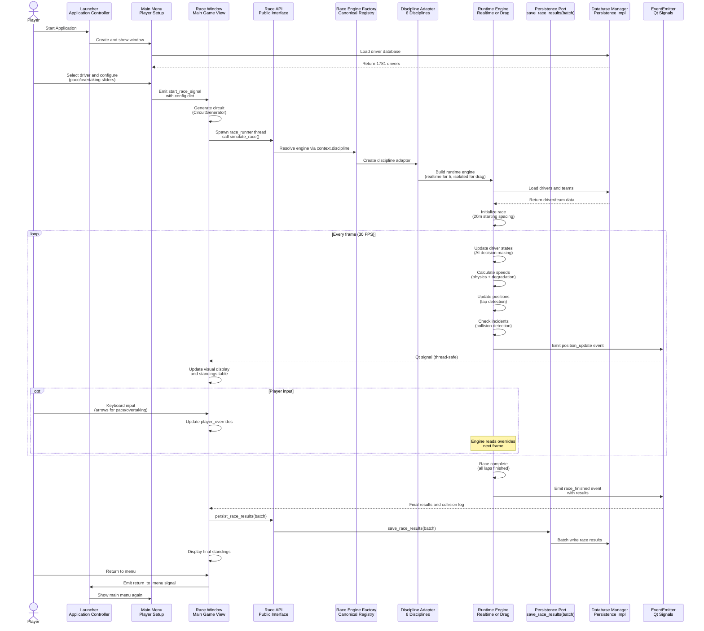

# Data Flow Sequence Diagram

This diagram shows the complete event flow from player starting a race to viewing the final results.

## Sequence Steps Explained

### 1. Application Startup
- Player launches Momentum
- Launcher creates QApplication and shows MainMenuWindow
- MainMenu loads driver database via DatabaseManager
- 1,781 drivers returned for selection

### 2. Player Configuration
- Player selects their driver from the list
- Player adjusts pace slider (0.0 to 1.0 - push intensity)
- Player adjusts overtaking aggression slider (0.0 to 1.0 - ATTACK threshold)
- Configuration stored in config dictionary

### 3. Race Initialization
- MainMenu emits start_race_signal with config
- RaceWindow receives signal and sets player driver
- CircuitGenerator creates procedural racing circuit
- RaceWindow spawns race_runner thread in background

### 4. Engine Setup
- race_runner thread calls simulate_race from RaceAPI
- RaceAPI asks RaceEngineFactory for discipline adapter
- Adapter builds either RealtimeRaceEngine (5 disciplines) or drag-specific engine
- Engine queries DatabaseManager for driver and team data
- Initialize race with 20 meter starting spacing to reduce first-lap collisions

### 5. Main Simulation Loop (30 FPS)
This loop runs 30 times per second in the race_runner thread:

**AI Decision Making:**
- For each driver call update_racing_mode
- Player-controlled drivers use player_overrides from sliders
- AI drivers evaluate gaps and track sections to choose ATTACK, DEFEND, or MANAGE mode
- Push intensity adjusted based on racing mode

**Physics Calculation:**
- Calculate speed using driver attributes, team capability, push intensity
- Apply tyre degradation, fuel weight, push fatigue
- Check for slipstream boost or dirty air penalty
- Apply collision avoidance logic

**Position Update:**
- Move car forward based on calculated speed and timestep (0.033 seconds)
- Update velocity and position values
- Sort drivers by lap and position

**Lap Detection:**
- Check if car crossed start/finish line (position modulo track length)
- If lap completed call complete_lap to record lap time
- Update best lap time if faster

**Collision Detection:**
- Check proximity to other cars (longitudinal gap < 10 meters)
- Evaluate if cars are racing wheel-to-wheel (ATTACK/DEFEND modes)
- Calculate contact probability based on driver skills and tyre condition
- Trigger DNF if collision occurs, log incident details

**Event Emission:**
- Create position event dictionary with all driver states
- Call event_callback with position data
- EventEmitter converts to Qt signal for thread safety
- RaceWindow receives signal on main thread
- Update visual display: redraw track with car positions
- Update standings table: position, driver name, lap, gap

### 6. Player Override System
When player presses keyboard arrows:
- RaceWindow captures keyPressEvent
- Up/down arrows adjust pace slider
- Left/right arrows adjust overtaking slider
- player_overrides dictionary updated with new values
- Engine reads overrides every frame for player's car
- AI logic skipped for player, manual control applied

### 7. Race Completion
- Engine detects all laps finished for all drivers
- Create final results with finishing positions, lap times, best laps
- Collect collision_log with all incidents
- Emit race_finished event with complete data
- RaceWindow delegates persistence to RaceAPI persist_race_results(batch)
- Persistence implementation saves through canonical save_race_results(batch)

### 8. Results Display
- RaceWindow receives race_finished event
- Display final standings table
- Show race statistics (fastest lap, incidents, DNFs)
- Player can review results

### 9. Return to Menu
- Player presses return to menu button
- RaceWindow emits return_to_menu signal
- Launcher receives signal and shows MainMenuWindow again
- Player can configure new race or exit

## Threading and Concurrency

**Main Thread (GUI):**
- PyQt event loop running continuously
- Handles all UI rendering and input
- Receives position events via Qt signals (thread-safe)
- Updates display and standings at 30 FPS

**Race Runner Thread (Simulation):**
- Spawned by RaceWindow when race starts
- Runs discipline-selected engine simulation loop
- Updates driver states 30 times per second
- Emits events back to main thread via EventEmitter
- Thread terminates when race finishes

**Thread Safety:**
- Qt signals automatically marshal data between threads
- EventEmitter uses pyqtSignal for position_update and race_finished
- No manual locking required, Qt handles synchronization
- player_overrides dictionary shared between threads (read-only from engine)

## Event Types

**position_update (emitted every frame):**
- current_time: race time in seconds
- drivers: list of driver states with id, name, position, lap, gap_ahead, gap_behind, best_lap_time
- Used to update visual display and standings table

**race_finished (emitted once at end):**
- results: final standings with finishing positions and times
- collision_log: list of all incidents with lap, time, position, type, involved drivers
- Used to display final results screen and trigger batch persistence
