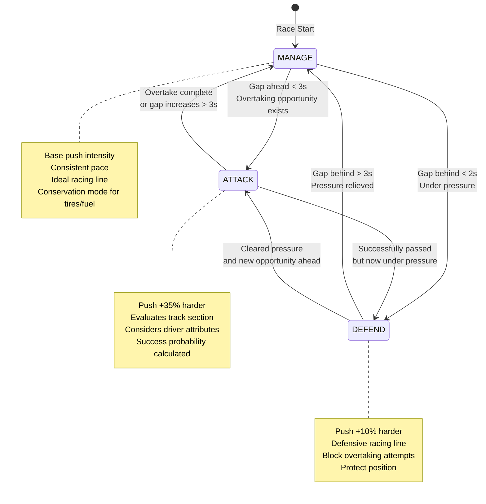

# Racing Mode State Diagram

This diagram shows the AI decision-making states and transitions for autonomous driver agents in Momentum.

## State Descriptions

**MANAGE** (Default State)
- Used when gaps are comfortable (>3s ahead and behind)
- Conservative push intensity based on driver personality
- Consistent drivers conserve more than aggressive drivers
- Ideal racing line
- Conservation mode for tire and fuel management

**ATTACK** (Overtaking State)
- Triggered when gap ahead < 3s and overtaking opportunity exists
- Push intensity increases by 35% from base
- Track-aware evaluation system checks:
  - Current track section (straight, slow corner, medium corner, fast corner, braking zone)
  - Driver attributes (aggression, raw speed, risk tolerance)
  - Success probability calculated based on gap, speed differential, and section type
- Logs overtaking attempts for visibility

**DEFEND** (Under Pressure State)
- Triggered when gap behind < 2s
- Push intensity increases by 10% from base
- Defensive racing line to block overtaking
- Considers track section for optimal defensive positioning
- Protects current position

## Transition Conditions

**MANAGE → ATTACK**
- Gap ahead drops below 3 seconds
- Track-aware system evaluates overtaking opportunity
- Considers section type and driver skill

**ATTACK → MANAGE**
- Overtaking attempt completes (successfully passed or abandoned)
- Gap ahead increases beyond 3 seconds
- No overtaking opportunity available

**MANAGE → DEFEND**
- Gap behind drops below 2 seconds
- Car behind is closing fast
- Need to protect position

**DEFEND → MANAGE**
- Gap behind increases beyond 3 seconds
- Pressure relieved
- Return to conservation mode

**ATTACK → DEFEND** (less common)
- Successfully passed car ahead
- But now under pressure from car behind
- Switch from offensive to defensive strategy

**DEFEND → ATTACK** (less common)
- Successfully defended position and cleared pressure (gap > 3s)
- New overtaking opportunity appears ahead (gap < 3s)
- Switch from defensive to offensive strategy

## Player Override System

Player-controlled drivers bypass this AI state machine:
- Player uses keyboard/sliders to set push intensity directly
- Overtaking aggression slider affects ATTACK threshold
- AI logic is completely skipped for player's car
- Full manual control over racing strategy
