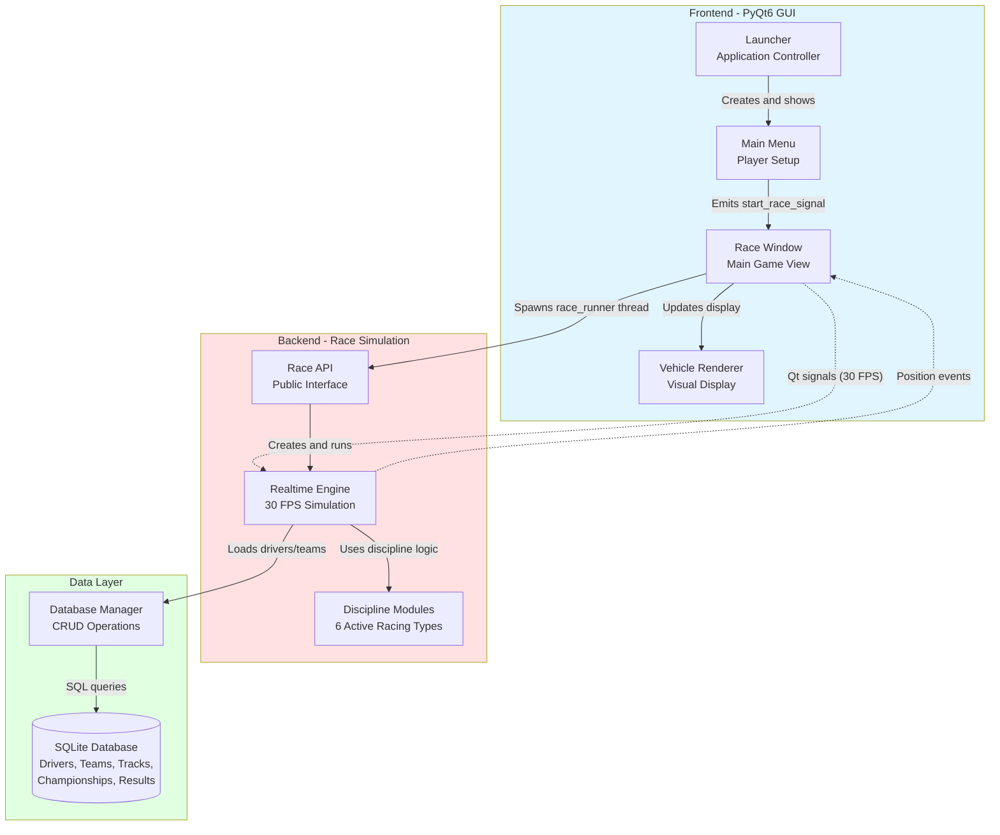

# System Architecture Diagram

This diagram shows the high-level architecture of Momentum's components and their relationships.

## Component Descriptions

### Frontend - PyQt6 GUI

**Launcher**
- Application controller managing lifecycle
- Initializes QApplication
- Manages window transitions
- Handles player configuration

**Main Menu**
- Player setup and configuration
- Driver database loading
- Pace and overtaking slider controls
- Emits start_race_signal with config

**Race Window**
- Core gameplay interface
- Circuit generation and display
- Race execution thread spawning
- Event handling (30 FPS position updates)
- Keyboard input for player overrides
- Live standings table

**Vehicle Renderer**
- Top-down sprite rendering using QPainter
- Deterministic livery generation
- Steering angle visualisation
- Polygon-based car bodies with wings and tyres

### Backend - Race Simulation

**Race API**
- Public interface for simulations
- Loads discipline adapters
- Orchestrates race execution
- Thread-safe event callbacks
- Supports both GUI and headless modes

**Realtime Engine**
- 30 FPS simulation loop
- AI decision making for all drivers
- Physics calculations (speed, position)
- Lap detection and timing
- Collision detection
- Degradation systems (tyres, fuel, fatigue)
- Position event emission

**Discipline Modules**
- Single Seater racing
- Production/Touring car racing
- Urban/Street (drifting) racing
- Drag/Acceleration racing
- Sprint/Rallycross racing
- Endurance racing
- Each inherits from BaseDisciplineEngine
- Legacy Rally Stage data is retained for compatibility and is not an active gameplay discipline

### Data Layer

**Database Manager**
- CRUD operations for all entities
- Transaction management
- Foreign key constraint enforcement
- Schema initialization
- Connection lifecycle management

**SQLite Database**
- Driver, team, track, and championship data
- Driver records include 50+ attributes each
- Championships and seasons
- Race results and telemetry
- Lap times and standings

## Data Flow Paths

1. **Player Configuration Flow**
   - Launcher → Main Menu → Race Window
   - Player selects driver and adjusts sliders
   - Config passed to Race Window

2. **Race Execution Flow**
   - Race Window → Race API → Realtime Engine
   - Engine initializes race with database data
   - Simulation runs at 30 FPS
   - Position events emitted back to GUI

3. **Visual Update Flow**
   - Realtime Engine → Race Window → Vehicle Renderer
   - Position events at 30 FPS
   - Qt signals ensure thread safety
   - Renderer draws updated car positions

4. **Database Query Flow**
   - Race Window/Engine → Database Manager → SQLite DB
    - Load drivers, teams, and tracks
   - Store race results and telemetry
   - Query championship standings

## Threading Model

**Main Thread (GUI)**
- PyQt event loop
- All UI rendering and input
- Receives position events via Qt signals

**Race Runner Thread (Simulation)**
- Realtime Engine execution
- 30 FPS tick loop
- Emits events to main thread
- Thread-safe via Qt signal/slot mechanism

## API Mode (Headless)

**Alternative Path:**
- FastAPI server under uvicorn
- REST endpoints for queries and simulation
- Background task execution
- No GUI components loaded
- Same backend logic (Race API, Engine, Database)
