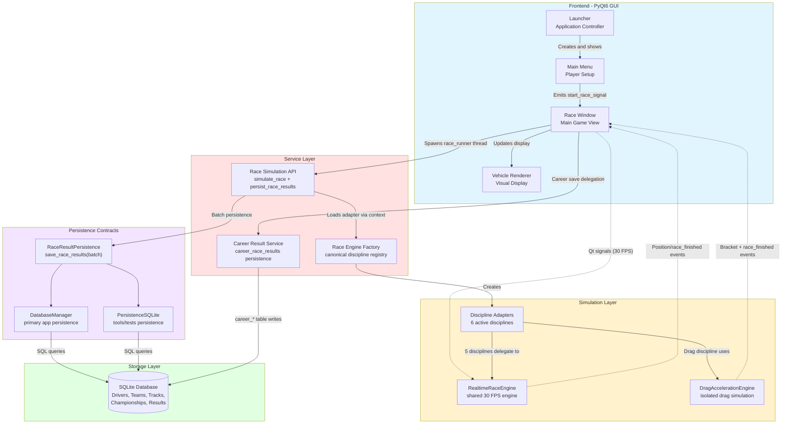

# System Architecture Diagram

This diagram shows the high-level architecture of Momentum's components and their relationships.

## Component Descriptions

### Frontend - PyQt6 GUI

**Launcher**
- Application controller managing lifecycle
- Initializes QApplication
- Manages window transitions
- Handles player configuration

**Main Menu**
- Player setup and configuration
- Driver database loading
- Pace and overtaking slider controls
- Emits start_race_signal with config

**Race Window**
- Core gameplay interface
- Circuit generation and display
- Race execution thread spawning
- Event handling (30 FPS position updates)
- Keyboard input for player overrides
- Live standings table

**Vehicle Renderer**
- Top-down sprite rendering using QPainter
- Deterministic livery generation
- Steering angle visualisation
- Polygon-based car bodies with wings and tyres

### Service Layer

**Race Simulation API**
- Single simulation entry point: `simulate_race`
- Canonical persistence adapter: `persist_race_results`
- Converts raw engine output to `RaceResult` batch objects
- Supports GUI race thread and headless execution

**Race Engine Factory**
- Canonical discipline registry for exactly 6 active disciplines
- Constructs discipline adapters through a single factory
- Enforces split: 5 realtime-wrapper disciplines + 1 isolated drag engine

**Career Result Service**
- Service-only wrapper for `career_race_results` writes
- Prevents direct GUI SQL writes for post-race career persistence

### Simulation Layer

**Discipline Adapters**
- Single Seater
- Production/Touring
- Urban/Street (drift)
- Drag/Acceleration
- Sprint/Rallycross
- Endurance
- All derive from `BaseDisciplineEngine`

**RealtimeRaceEngine**
- 30 FPS simulation loop
- AI decision making for all drivers
- Physics calculations (speed, position)
- Lap detection and timing
- Collision detection
- Degradation systems (tyres, fuel, fatigue)
- Position event emission

**DragAccelerationEngine**
- Isolated drag-specific bracket and elimination simulation path
- Does not run through `RealtimeRaceEngine`

### Persistence Contracts

**RaceResultPersistence**
- Shared interface requiring `save_race_results(race_result_batch)`
- Legacy `save_race_result` and `create_race_result` are compatibility wrappers

**DatabaseManager**
- Main application persistence implementation
- Batch save deletes/replaces race rows per race_id

**PersistenceSQLite**
- Secondary implementation for scripts and MVP tests
- Same canonical batch signature as `DatabaseManager`

### Data Layer

**Database Manager**
- CRUD operations for all entities
- Transaction management
- Foreign key constraint enforcement
- Schema initialization
- Connection lifecycle management

**SQLite Database**
- Driver, team, track, and championship data
- Driver records include 50+ attributes each
- Championships and seasons
- Race results and telemetry
- Lap times and standings

## Data Flow Paths

1. **Player Configuration Flow**
   - Launcher → Main Menu → Race Window
   - Player selects driver and adjusts sliders
   - Config passed to Race Window

2. **Race Execution Flow**
    - Race Window → Race API (`simulate_race`) → Race Engine Factory
    - Factory resolves discipline adapter from canonical registry
    - Adapter runs either RealtimeRaceEngine (5 disciplines) or DragAccelerationEngine (drag)
    - Position events emitted back to GUI via callback bridge

3. **Visual Update Flow**
   - Realtime Engine → Race Window → Vehicle Renderer
   - Position events at 30 FPS
   - Qt signals ensure thread safety
   - Renderer draws updated car positions

4. **Database Query Flow**
    - GUI/Service → Race Simulation API `persist_race_results` → RaceResultPersistence implementation
    - RaceResultPersistence implementation → SQLite DB
    - Load drivers, teams, and tracks
   - Store race results and telemetry
    - Store race results in canonical batch writes
   - Query championship standings

## Threading Model

**Main Thread (GUI)**
- PyQt event loop
- All UI rendering and input
- Receives position events via Qt signals

**Race Runner Thread (Simulation)**
- Realtime Engine execution
- 30 FPS tick loop
- Emits events to main thread
- Thread-safe via Qt signal/slot mechanism

## API Mode (Headless)

**Alternative Path:**
- FastAPI server under uvicorn
- REST endpoints for queries and simulation
- Background task execution
- No GUI components loaded
- Same simulation and persistence service adapters as desktop mode
