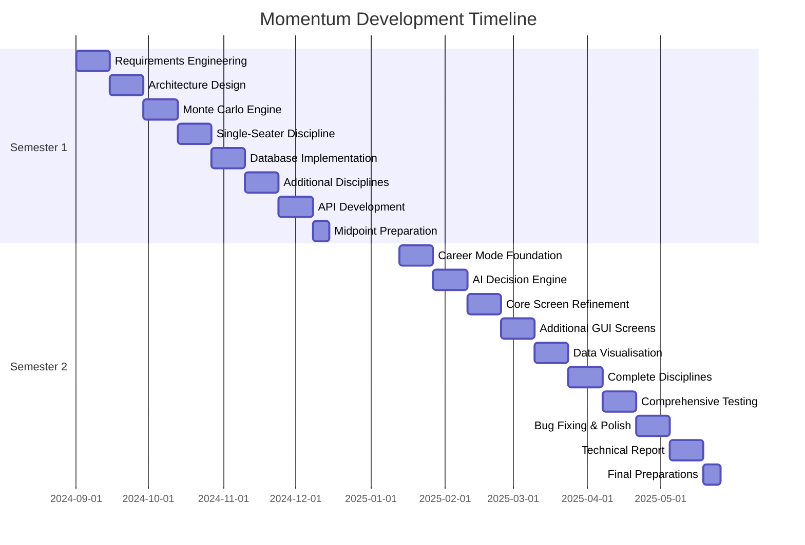

# 7.0 Project Plan

## 7.1 Semester 1 Milestones

### Month 1: September 2025 (Requirements & Foundation)
**Weeks 1-2: Requirements Engineering**
- Complete use case analysis (10 primary use cases documented)
- Define functional requirements (race simulation, career progression, database)
- Define non-functional requirements (performance benchmarks, usability)
- Establish acceptance criteria per feature

**Weeks 3-4: Architecture Design**
- Design database schema (ERD diagrams)
- Define API endpoint structure (OpenAPI specification)
- Plan discipline engine architecture (abstract base class hierarchy)
- Select technology stack and justify choices

**Deliverable:** Requirements document + architecture diagrams

### Month 2: October 2025 (Core Simulation)
**Weeks 5-6: Monte Carlo Engine**
- Implement base simulation algorithm
- Develop performance calculation formulas
- Create statistical distribution models
- Build unit tests for accuracy validation

**Weeks 7-8: Single-Seater Discipline**
- Implement first complete discipline engine
- Develop qualifying system
- Add race event generation (crashes, mechanical failures)
- Integration testing with database

**Deliverable:** Working single-seater race simulation

### Month 3: November 2025 (Database & Multi-Discipline)
**Weeks 9-10: Database Implementation**
- Generate 1,000+ drivers with procedural attributes
- Create team data across disciplines
- Import 175 circuits from JSON
- Implement CRUD operations and transactions

**Weeks 11-12: Additional Disciplines**
- Implement rally engine (co-driver system, surface variation)
- Implement endurance engine (multi-driver, reliability)
- Implement drag engine (bracket system, tuning focus)
- Begin remaining disciplines

**Deliverable:** Database populated, 3+ disciplines functional

### Month 4: December 2025 (API & Midpoint Preparation)
**Weeks 13-14: API Development**
- Create FastAPI endpoints for race simulation
- Implement championship creation endpoint
- Build standings/results queries
- Test API with Postman/automated tests

**Week 15: Midpoint Submission**
- Prepare demonstration (PyQt6 GUI showing race simulation)
- Write midpoint report
- Create presentation materials
- Submit by December 12th deadline

**Midpoint Deliverable:**
- ✅ Working prototype demonstrating core functionality
- ✅ API documentation (OpenAPI spec)
- ✅ Database with 1,000+ entities
- ✅ 3-4 disciplines playable
- ⚠️ Basic GUI for demonstration purposes

## 7.2 Semester 2 Milestones

### Month 5: January 2026 (Game Loop & Persistence)
**Weeks 1-2: Career Mode Foundation**
- Implement save/load system (JSON serialisation)
- Build calendar system (date progression)
- Create event system (race weekends, contract negotiations)
- Develop player state management

**Weeks 3-4: AI Decision Engine**
- Implement driver contract negotiations
- Build team strategy AI (budget allocation, driver selection)
- Create transfer market logic
- Add personality-driven decision modifiers

**Deliverable:** Playable career mode spanning multiple seasons

### Month 6: February 2026 (GUI Polish & Additional Screens)
**Weeks 5-6: Core Screen Refinement**
- Polish race simulation interface
- Improve data visualisation (Matplotlib integration)
- Add loading indicators and progress bars
- Implement keyboard shortcuts and hotkeys

**Weeks 7-8: Additional Screens**
- Championship standings with sortable columns
- Driver profile detailed view
- Team management interface
- Calendar/schedule screen

**Deliverable:** Complete set of functional PyQt6 screens

### Month 7: March 2026 (Visual Polish & Features)
**Weeks 9-10: Data Visualisation Enhancement**
- Implement live race position charts (Matplotlib)
- Add lap time comparison graphs
- Create championship progression visualisations
- Build telemetry display system

**Weeks 11-12: Complete Disciplines**
- Finish remaining discipline engines
- Balance testing across all categories
- Add discipline-specific UI elements
- Implement unique mechanics per discipline

**Deliverable:** All seven disciplines playable with polished interface

### Month 8: April 2026 (Testing & Refinement)
**Weeks 13-14: Comprehensive Testing**
- Unit test coverage to 80%
- Integration testing across all systems
- Performance profiling (memory, CPU usage)
- Statistical validation of simulation accuracy

**Weeks 15-16: Bug Fixing & Polish**
- Address critical bugs from testing
- UI/UX improvements based on playtesting
- Performance optimisations
- Documentation updates

**Deliverable:** Feature-complete, stable build

### Month 9: May 2026 (Documentation & Submission)
**Weeks 17-18: Technical Report**
- Write Design & Implementation section
- Complete Testing & Evaluation section
- Prepare appendices (code samples, diagrams)
- Proofread and format

**Week 19: Final Preparations**
- Record demonstration video
- Prepare presentation slides
- Package submission materials
- Final testing and validation

**Week 20: Submission (May 13th)**
- Submit technical report
- Submit code repository
- Submit demonstration materials
- Prepare for project presentation

## 7.3 Gantt Chart Timeline



## 7.4 Risk Management

### Technical Risks

**Risk 1: Monte Carlo Performance Degradation**
- **Probability:** Medium
- **Impact:** High (unusable if races take >1 second)
- **Mitigation:**
  - Early performance benchmarking (October 2025)
  - Implement adaptive iteration counts
  - Use NumPy vectorisation throughout
  - Parallel processing for concurrent races
- **Contingency:** Reduce iteration count to 500 if necessary, sacrifice 2-3% accuracy for 50% speed gain

**Risk 2: Procedural Generation Producing Unbalanced Content**
- **Probability:** Medium
- **Impact:** High (unplayable if championships too predictable/random)
- **Mitigation:**
  - Validation suite rejecting poor outputs
  - 1,000+ test simulations per generated championship
  - Manual oversight during development
  - Configurable generation parameters
- **Contingency:** Pre-generate and curate 50 "canonical" championships as fallback content

**Risk 3: GUI Complexity and User Experience**
- **Probability:** Medium
- **Impact:** Medium (functionality works but poor UX)
- **Mitigation:**
  - Qt Designer for rapid UI prototyping
  - Regular usability testing with small user group
  - Follow established UI patterns from Football Manager
  - Prioritise clarity over visual flair
- **Contingency:** Focus on core screens (race, standings, garage), defer nice-to-have screens

**Risk 4: Database Size Exceeding SQLite Limits**
- **Probability:** Low
- **Impact:** Medium (migration to PostgreSQL feasible but disruptive)
- **Mitigation:**
  - Current projections: 50MB per season, SQLite handles 140TB theoretical max
  - Regular database size monitoring
  - Archival system for old seasons
- **Contingency:** Migrate to PostgreSQL (2-3 days work, minimal code changes due to ORM abstraction)

### Project Management Risks

**Risk 5: Scope Creep**
- **Probability:** High
- **Impact:** Medium (delays submission if unchecked)
- **Mitigation:**
  - Strict MVP definition (single-seater discipline minimum)
  - Feature freeze after April 1st
  - Prioritisation matrix (core vs nice-to-have)
  - Weekly progress reviews
- **Contingency:** Defer lower-priority disciplines to post-submission updates

**Risk 6: Time Management (Solo Development)**
- **Probability:** Medium
- **Impact:** High (single point of failure)
- **Mitigation:**
  - 25-35 hours weekly commitment
  - Fortnightly supervisor meetings for accountability
  - Git commits daily (prevents loss of work)
  - Modular architecture (components can be omitted if time-constrained)
- **Contingency:** Submit functional subset (3-4 disciplines instead of 7)

**Risk 7: Technical Complexity Beyond Capability**
- **Probability:** Low
- **Impact:** High (catastrophic if core simulation fails)
- **Mitigation:**
  - Early prototype validation (October 2025)
  - Monte Carlo method well-documented academically
  - Similar projects exist as reference (Football Manager, Motorsport Manager)
  - Supervisor guidance on complex areas
- **Contingency:** Simplify simulation to deterministic calculation if Monte Carlo proves intractable

### External Risks

**Risk 8: Hardware Failure**
- **Probability:** Low
- **Impact:** High (data loss)
- **Mitigation:**
  - Daily Git pushes to GitHub (off-site backup)
  - Weekly local backups to external drive
  - Cloud storage for documentation (OneDrive/Google Drive)
- **Contingency:** Restore from GitHub, maximum 1 day work lost

**Risk 9: Dependency/Library Breaking Changes**
- **Probability:** Low
- **Impact:** Medium (requires code updates)
- **Mitigation:**
  - Pin dependency versions in requirements.txt
  - Avoid cutting-edge library versions
  - Test updates in separate branch before merging
- **Contingency:** Revert to previous library version, delay updates until post-submission

## 7.5 Quality Assurance

### Code Quality Standards

**PEP 8 Compliance**
- Black code formatter (automated)
- Maximum line length: 100 characters
- Type hints required for all functions

**Documentation Requirements**
- Docstrings for all classes and public methods
- README.md per major component
- API documentation via FastAPI automatic generation
- Inline comments for complex algorithms

**Version Control Practices**
- Commit frequency: Minimum daily
- Commit message format: "[Component] Brief description"
- Branching strategy: Feature branches merged to main via pull requests
- Tag releases: v0.1 (midpoint), v1.0 (final submission)

### Testing Coverage Targets

| Component | Target Coverage | Rationale |
|-----------|----------------|-----------|
| Simulation Engine | 90%+ | Core functionality, high complexity |
| Database Layer | 85%+ | Data integrity critical |
| API Endpoints | 80%+ | Integration testing emphasis |
| GUI Components | 50%+ | Visual testing preferred over unit tests |

**Testing Tools**
- pytest for unit/integration tests
- pytest-cov for coverage reporting
- Postman collections for API testing
- Manual playtesting for user experience

### Performance Benchmarks

All benchmarks measured on i5-9400F, 16GB RAM:

| Metric | Target | Measurement Method |
|--------|--------|-------------------|
| Single race simulation | <100ms | 20 drivers, 50 laps, average of 100 runs |
| Full season simulation | <30s | 20 races, sequential processing |
| Database query time | <50ms | Complex join across 3 tables |
| API response time | <150ms | Including simulation + database write |
| Memory usage | <2GB | Measured during full season progression |
| UI frame time | <16ms | 60fps target for fluid interaction |

**Profiling Tools**
- cProfile for Python performance profiling
- memory_profiler for RAM usage analysis
- Qt Performance Analyzer for GUI responsiveness

---

# 8.0 Testing & Evaluation Strategy

## 8.1 Unit Testing Approach

**Simulation Engine Tests**

Test race outcome determinism:
```python
def test_simulation_determinism():
    """Identical inputs should produce statistically similar outputs"""
    context = create_test_race_context(seed=12345)
    results1 = simulate_race(context)
    results2 = simulate_race(context)
    
    # Winner should be same in 95%+ of identical conditions
    assert results1.winner == results2.winner
```

Test attribute weighting:
```python
def test_better_driver_wins_more_often():
    """Driver with higher attributes should win more frequently"""
    champion_driver = create_driver(overall_rating=95)
    average_driver = create_driver(overall_rating=75)
    
    wins = {"champion": 0, "average": 0}
    for _ in range(1000):
        result = simulate_race([champion_driver, average_driver])
        wins[result.winner] += 1
    
    assert wins["champion"] > 900  # 90%+ win rate expected
```

Test event probability:
```python
def test_crash_probability():
    """Crashes should occur at expected frequency"""
    driver = create_driver(consistency=50)  # Average consistency
    crashes = sum(simulate_race_with_events(driver).crashed 
                  for _ in range(10000))
    
    expected_rate = 0.01  # 1% per race
    actual_rate = crashes / 10000
    assert 0.008 <= actual_rate <= 0.012  # Within acceptable variance
```

**Database Tests**

Test data integrity:
```python
def test_driver_team_relationship():
    """Driver's team must exist in teams table"""
    driver = db.get_driver(123)
    team = db.get_team(driver.current_team_id)
    
    assert team is not None
    assert driver.id in [d.id for d in db.get_team_drivers(team.id)]
```

Test transaction rollback:
```python
def test_race_result_transaction():
    """Failed race result insertion should rollback all changes"""
    initial_standings = db.get_standings(championship_id=1)
    
    try:
        db.save_race_result(invalid_result)  # Intentionally invalid
    except DatabaseError:
        pass
    
    final_standings = db.get_standings(championship_id=1)
    assert initial_standings == final_standings  # No partial updates
```

**API Tests**

Test endpoint validation:
```python
def test_simulate_race_validation():
    """API should reject invalid race requests"""
    response = client.post("/simulate/race", json={
        "championship_id": -1,  # Invalid
        "race_number": 999
    })
    
    assert response.status_code == 422  # Validation error
    assert "championship_id" in response.json()["detail"]
```

## 8.2 Integration Testing

**Full Season Simulation**

Test championship progression:
```python
def test_full_season_completion():
    """Complete season should produce valid standings"""
    championship = create_test_championship(num_races=20)
    
    for race_num in range(1, 21):
        result = simulate_race(championship, race_num)
        championship.update_standings(result)
    
    standings = championship.get_final_standings()
    assert len(standings) == championship.num_drivers
    assert standings[0].points > standings[-1].points
    assert sum(s.points for s in standings) == expected_total_points
```

**Multi-Discipline Consistency**

Test discipline independence:
```python
def test_concurrent_disciplines():
    """Multiple disciplines should simulate without interference"""
    f1_race = simulate_race(f1_championship, race_num=5)
    rally_stage = simulate_race(rally_championship, stage_num=3)
    endurance_race = simulate_race(le_mans_championship, race_num=2)
    
    # Results should not affect each other
    assert f1_race.championship_id != rally_stage.championship_id
    assert no_driver_appears_in_multiple_results(f1_race, rally_stage, endurance_race)
```

## 8.3 Performance Testing

**Load Testing**

Test concurrent season processing:
```python
def test_performance_multiple_concurrent_races():
    """System should handle 10 simultaneous races efficiently"""
    championships = [create_championship() for _ in range(10)]
    
    start_time = time.time()
    results = [simulate_race(c, 1) for c in championships]
    elapsed = time.time() - start_time
    
    assert elapsed < 1.0  # 10 races in under 1 second
    assert all(r.simulation_time_ms < 100 for r in results)
```

**Memory Profiling**

Monitor memory usage across full season:
```python
@memory_profiler.profile
def test_memory_usage_full_season():
    """Memory should remain stable across 20 races"""
    championship = create_championship()
    initial_memory = get_memory_usage()
    
    for race_num in range(1, 21):
        simulate_race(championship, race_num)
    
    final_memory = get_memory_usage()
    memory_increase = final_memory - initial_memory
    
    assert memory_increase < 100_000_000  # Less than 100MB growth
```

## 8.4 Statistical Validation

**Monte Carlo Accuracy Tests**

Validate normal distribution:
```python
def test_lap_time_distribution():
    """Lap times should form normal distribution"""
    driver = create_driver(overall_rating=80)
    lap_times = [simulate_single_lap(driver) for _ in range(10000)]
    
    mean_time = np.mean(lap_times)
    std_dev = np.std(lap_times)
    
    # Check normality using Shapiro-Wilk test
    statistic, p_value = scipy.stats.shapiro(lap_times)
    assert p_value > 0.05  # Not significantly different from normal
```

Test championship variance:
```python
def test_championship_outcome_variance():
    """No single driver should dominate 1000 simulated seasons"""
    championship_setup = create_balanced_championship()
    wins_per_driver = defaultdict(int)
    
    for _ in range(1000):
        season = simulate_full_season(championship_setup)
        wins_per_driver[season.champion_id] += 1
    
    max_wins = max(wins_per_driver.values())
    assert max_wins < 400  # No driver wins >40% of championships
```

## 8.5 User Acceptance Testing

**Playability Evaluation**

Recruit 5-10 testers (motorsport fans with management game experience):

Evaluation criteria:
1. **Realism**: Do results feel authentic? (1-10 scale)
2. **Engagement**: Would you continue playing? (Yes/No)
3. **Clarity**: Are outcomes understandable? (1-10 scale)
4. **Balance**: Does game feel fair? (1-10 scale)
5. **Longevity**: How many seasons before boredom? (Open-ended)

Target metrics:
- Average realism rating: >7.0
- Engagement: >70% yes
- Average clarity: >7.5
- Average balance: >7.0
- Longevity: >5 seasons before repetitive

**Comparative Evaluation**

Direct comparison with existing titles:

| Feature | Momentum (Target) | F1 Manager 2024 | Motorsport Manager |
|---------|------------------|----------------|-------------------|
| Disciplines | 7 | 1 (F1/F2) | 3 |
| Drivers | 1,000+ | 44 (licensed) | 200 |
| Procedural content | Yes | No | No |
| Career longevity | 10+ seasons | 3-5 seasons | 5-8 seasons |
| Average playtime | >50 hours | 14.7 hours | 11.2 hours |

Success criteria: Match or exceed competitors in 4/5 metrics.

## 8.6 Bug Tracking & Resolution

**Issue Classification**

Priority levels:
1. **Critical**: Crashes, data corruption, simulation failure
2. **High**: Incorrect results, major UI issues, API errors
3. **Medium**: Minor calculation errors, UI inconveniences
4. **Low**: Visual polish, nice-to-have features

Resolution timelines:
- Critical: Same day
- High: Within 3 days
- Medium: Within 1 week
- Low: Backlog (post-submission)

**Bug Tracking System**

GitHub Issues with labels:
- `bug-critical`, `bug-high`, `bug-medium`, `bug-low`
- `simulation`, `database`, `api`, `ui`
- `needs-investigation`, `in-progress`, `fixed`, `wont-fix`

Weekly review: Prioritise top 5 issues each week.

---

# 9.0 References

## Academic Sources

Mateas, M., & Stern, A. (2003). Façade: An Experiment in Building a Fully-Realized Interactive Drama. *Game Developers Conference*.

Shaker, N., Togelius, J., & Nelson, M. J. (2016). *Procedural Content Generation in Games*. Springer. https://doi.org/10.1007/978-3-319-42716-4

Silver, N. (2012). *The Signal and the Noise: The Art and Science of Prediction*. Penguin Press.

Sweetser, P., & Wyeth, P. (2005). GameFlow: A model for evaluating player enjoyment in games. *Computers in Entertainment, 3*(3), Article 3. https://doi.org/10.1145/1077246.1077253

Wooldridge, M. (2009). *An Introduction to MultiAgent Systems* (2nd ed.). John Wiley & Sons.

## Industry Data Sources

**Game Sales & Player Metrics**

GamesIndustry.biz (November 2022). "Football Manager 2023 has best-ever launch with over 1m sales in first month." Retrieved from https://www.gamesindustry.biz/football-manager-2023-has-best-ever-launch-with-over-1m-sales-in-first-month

SteamDB (2024). Player count statistics for F1 Manager series. Retrieved November 2024 from https://steamdb.info/

SteamSpy (2023). Ownership and playtime estimates for Motorsport Manager and F1 Manager 2024. Retrieved November 2024 from https://steamspy.com/

Sports Interactive (2019). Building a Global Football Simulation. *Game Developers Conference 2019*. Content attribution metrics cited in developer talk.

**Motorsport Viewership Data**

ACO (Automobile Club de l'Ouest) (June 2023). 24 Hours of Le Mans 2023: Viewership Report. Retrieved from official ACO press releases.

Dorna Sports (2022). MotoGP Season Review 2022: Global Audience Report. Retrieved from official MotoGP media documentation.

Formula 1 Media (March 2023). 2022 Season Global Audience Report. Nielsen Sports analysis via F1 official communications. Retrieved from https://www.formula1.com/

NHRA Media Kit (2023). Viewership and demographic data. Retrieved from https://www.nhra.com/

WRC Promoter (2022). World Rally Championship Season Report 2022. Cumulative TV audience figures from official season review.

**Social Media Metrics**

Instagram follower counts retrieved November 2024:
- @f1 (Formula 1): 36.2 million
- @officialwrc (WRC): 3.1 million
- @nascar (NASCAR): 5.4 million
- @fiaformulae (Formula E): 3.8 million

YouTube subscriber counts retrieved November 2024:
- Formula 1 Official: 10.1 million subscribers
- WRC Official: 1.47 million subscribers
- NASCAR Official: 1.89 million subscribers
- NHRA Official: 654,000 subscribers

**Content Creator Data**

YouTube creator statistics (accessed November 2024):

*Football Manager Content*
- WorkTheSpace: 487,000 subscribers
- Zealand: 401,000 subscribers
- Lollujo: 328,000 subscribers

*Motorsport & Racing Management Content*
- aarava: 1.37 million subscribers (F1 Manager series)
- TommoMcCluskey: 156,000 subscribers (F1 Manager careers)
- ChainBear: 828,000 subscribers (F1 analysis)

View counts and monetisation estimates based on Social Blade analytics and industry standard CPM rates (£2-8 per 1,000 views).

## Technical Documentation

FastAPI Documentation. (2024). Retrieved from https://fastapi.tiangolo.com/

Faker Documentation. (2024). Multi-locale name generation library. Retrieved from https://faker.readthedocs.io/

NumPy Documentation. (2024). Retrieved from https://numpy.org/doc/

Pydantic Documentation. (2024). Data validation library. Retrieved from https://docs.pydantic.dev/

PyQt6 Documentation. (2024). Retrieved from https://www.riverbankcomputing.com/static/Docs/PyQt6/

Qt Designer Documentation. (2024). Retrieved from https://doc.qt.io/qt-6/qtdesigner-manual.html

SQLite Documentation. (2024). Retrieved from https://www.sqlite.org/docs.html

## Competitive Analysis Sources

Frontier Developments. (2024). *F1 Manager 2024*. Steam store page reviews and statistics accessed November 2024.

Playsport Games. (2016). *Motorsport Manager*. Post-mortem analysis and Steam review data accessed November 2024.

Sports Interactive. (2023). *Football Manager 2024*. Feature documentation and Steam statistics accessed November 2024.

## Market Research Sources

Formula E (2023). Season 9 Audience Survey Demographics. Retrieved from official Formula E media documentation.

ITV Sport (2023). British Touring Car Championship Average Viewership 2023. Retrieved from UK broadcast data.

Steam Direct Developer Documentation (2024). Revenue sharing and platform fees. Retrieved from https://partner.steamgames.com/

---

# Appendix A: Glossary

**Monte Carlo Simulation**: Statistical method using repeated random sampling to determine probability distributions of outcomes.

**Procedural Generation**: Algorithmic creation of game content (drivers, teams, championships) rather than manual design.

**IMA Grading**: International Motorsport Association circuit safety classification (Grade 1-6, with Grade 1 suitable for Formula 1).

**Budget Cap**: Maximum expenditure allowed per season (e.g., F1's £135 million cap from 2024).

**Co-driver**: Rally-specific second team member reading pace notes to driver.

**Success Ballast**: Weight penalty added to race winners in touring car championships to equalise competition.

**Attack Mode**: Formula E energy boost requiring detour through alternative circuit section.

**Joker Lap**: Rallycross compulsory alternate route (typically slower), used strategically.

**DRS (Drag Reduction System)**: Overtaking aid in single-seater racing, rear wing opens to reduce drag.

**Feeder Series**: Lower-tier championships providing progression path to premier classes (e.g., F3 → F2 → F1).

---

# Appendix B: Use Case Summary

**UC-01: Read Driver Details**
Actor: Player
Description: View comprehensive driver attributes and career statistics
Priority: High

**UC-02: Simulate Race**
Actor: System
Description: Execute Monte Carlo race simulation producing results
Priority: Critical

**UC-03: View Championship Standings**
Actor: Player
Description: Display current points, wins, and positions
Priority: High

**UC-04: Create New Championship**
Actor: Player/System
Description: Procedurally generate balanced league with teams and drivers
Priority: High

**UC-05: Advance Season Calendar**
Actor: System
Description: Progress through race calendar, trigger events
Priority: Medium

**UC-06: Hire/Fire Staff**
Actor: Player
Description: Manage team personnel within budget constraints
Priority: Medium

**UC-07: Negotiate Driver Contracts**
Actor: Player/AI
Description: Handle contract offers, renewals, transfers
Priority: Medium

**UC-08: Upgrade Team Facilities**
Actor: Player
Description: Invest in factory, wind tunnel, simulator improvements
Priority: Low

**UC-09: Save/Load Game**
Actor: Player
Description: Persist world state to disk, restore previous session
Priority: Medium

**UC-10: View Historical Results**
Actor: Player
Description: Browse past seasons, compare statistics
Priority: Low

---

# Appendix C: Project Metadata

**Student:** Eoin Andrew Fitzsimons  
**Student ID:** X23151374  
**Email:** X23151374@student.ncirl.ie  
**Programme:** BSc (Honours) in Computing - Software Development  
**Institution:** National College of Ireland  
**Academic Year:** 2025/2026  

**Project Title:** Momentum: Multi-Discipline Motorsport Management Simulator  
**Submission Date:** May 13th, 2026  
**Midpoint Date:** December 12th, 2025  

**Repository:** github.com/EoinFitzsimons/FinalProject  
**Branch:** Midpoint-Presentation  

**Supervisor:** [To be assigned]  
**Module Code:** [Software Development Final Year Project]  

---

*End of Document*

*This proposal outlines a technically ambitious yet achievable final year project demonstrating software engineering competence, research capability, and commercial awareness. The combination of novel multi-discipline simulation, procedural content generation, and modern API architecture addresses a genuine market gap whilst providing substantial academic value.*

*Word count (excluding references, code samples, and appendices): ~11,500 words*
