# ERD (Detailed): Mermaid class diagram listing all table fields

The diagram below lists every field present in the canonical schema (`Momentum/Python/database/models.py` / `SCHEMA_SQL`). Field types and primary/foreign keys are shown.

```mermaid
classDiagram

    class drivers {
        INTEGER id <<PK>>
        TEXT name
        TEXT nationality
        TEXT birth_date
        INTEGER age
        REAL raw_speed
        REAL consistency
        REAL racecraft
        REAL overtaking
        REAL defensive_driving
        REAL cornering_skill
        REAL braking_technique
        REAL acceleration_control
        REAL spatial_awareness
        REAL vehicle_control
        REAL physical_fitness
        REAL reaction_time
        REAL concentration
        REAL pressure_handling
        REAL pain_tolerance
        REAL g_force_tolerance
        REAL coordination
        REAL multitasking
        REAL mental_resilience
        REAL adrenaline_management
        REAL setup_knowledge
        REAL mechanical_sympathy
        REAL tire_management
        REAL fuel_management
        REAL aerodynamics_understanding
        REAL suspension_feel
        REAL engine_management
        REAL data_analysis
        REAL single_seater_aptitude
        REAL touring_car_aptitude
        REAL rally_aptitude
        REAL street_racing_aptitude
        REAL drag_racing_aptitude
        REAL rallycross_aptitude
        REAL endurance_aptitude
        REAL race_strategy
        REAL pit_entry_exit
        REAL traffic_management
        REAL qualifying_pace
        REAL race_pace
        REAL starting_skill
        REAL tyre_warming
        REAL energy_management
        REAL wet_weather_skill
        REAL night_driving
        REAL heat_tolerance
        REAL cold_tolerance
        REAL altitude_adaptation
        REAL visibility_adaptation
        REAL surface_adaptation
        REAL media_handling
        REAL sponsorship_appeal
        REAL fan_engagement
        REAL team_player
        REAL leadership
        REAL professionalism
        INTEGER career_wins
        INTEGER career_podiums
        INTEGER career_points
        TEXT biography
        INTEGER current_team_id <<FK>>
        TIMESTAMP created_at

        +get_discipline_rating(discipline: str): float
        +get_overall_rating(): float
        +skill(): float
        +adaptability(): float
        +aggression(): float
        +first_name(): str
        +last_name(): str
    }

    class teams {
        INTEGER id <<PK>>
        TEXT name
        TEXT nationality
        INTEGER founded_year
        TEXT discipline
        TEXT tier
        REAL budget
        TEXT headquarters
        TEXT team_principal
        TEXT biography
        INTEGER total_wins
        INTEGER total_podiums
        INTEGER championships
        TIMESTAMP created_at
    }

    class tracks {
        INTEGER id <<PK>>
        TEXT name
        TEXT country
        TEXT region
        TEXT circuit_type
        TEXT ima_grade
        TEXT primary_discipline
        REAL length_km
        INTEGER turns
        INTEGER left_turns
        INTEGER right_turns
        REAL elevation_change_m
        REAL max_gradient_percent
        REAL min_gradient_percent
        TEXT surface
        REAL track_width_avg_m
        REAL track_width_min_m
        REAL track_width_max_m
        REAL avg_speed_kmh
        REAL top_speed_kmh
        INTEGER longest_straight_m
        INTEGER shortest_straight_m
        REAL tightest_corner_radius_m
        TEXT climate
        REAL avg_temp_summer_c
        REAL avg_temp_winter_c
        INTEGER rainfall_mm_annual
        INTEGER altitude_m
        INTEGER pit_boxes
        REAL pit_lane_length_m
        INTEGER pit_speed_limit_kmh
        INTEGER paddock_capacity_teams
        INTEGER grandstand_capacity
        INTEGER drs_zones
        REAL safety_car_probability
        INTEGER night_racing_capable
        INTEGER wet_weather_racing
        INTEGER is_active
        INTEGER debut_year
        INTEGER last_used_year
        TEXT surface_type
        REAL difficulty
        REAL weather_impact
        REAL overtaking_difficulty
        TEXT discipline
        TEXT lap_record_time
        TEXT description
        TIMESTAMP created_at
    }

    class championships {
        INTEGER id <<PK>>
        TEXT name
        TEXT discipline
        TEXT tier
        INTEGER season_length
        TEXT points_system
        INTEGER current_season
        INTEGER founded_year
        TEXT description
        TIMESTAMP created_at
    }

    class races {
        INTEGER id <<PK>>
        INTEGER championship_id <<FK>>
        INTEGER track_id <<FK>>
        INTEGER season
        INTEGER round_number
        TEXT race_date
        TEXT weather_conditions
        INTEGER race_duration_minutes
        TEXT status
        TIMESTAMP created_at

        +circuit_id(): int
        +discipline(): str
    }

    class race_results {
        INTEGER id <<PK>>
        INTEGER race_id <<FK>>
        INTEGER driver_id <<FK>>
        INTEGER team_id <<FK>>
        INTEGER position
        INTEGER points
        BOOLEAN fastest_lap
        TEXT dnf_reason
        INTEGER grid_position
        TIMESTAMP created_at
    }

    class staff_members {
        INTEGER id <<PK>>
        TEXT name
        TEXT nationality
        TEXT birth_date
        INTEGER age
        INTEGER current_team_id <<FK>>
        TEXT role
        TEXT tier
        REAL technical_expertise
        INTEGER experience_years
        REAL management_skill
        REAL innovation_ability
        REAL problem_solving
        REAL attention_to_detail
        REAL work_under_pressure
        REAL adaptability
        REAL learning_speed
        REAL decision_making
        REAL aerodynamics_knowledge
        REAL engine_knowledge
        REAL suspension_knowledge
        REAL tire_knowledge
        REAL electronics_knowledge
        REAL data_analysis_skill
        REAL cfd_expertise
        REAL simulation_expertise
        REAL race_strategy_skill
        REAL team_leadership
        REAL negotiation_skill
        REAL budget_management
        REAL resource_allocation
        REAL long_term_planning
        REAL risk_assessment
        REAL communication
        REAL driver_relationship
        REAL team_motivation
        REAL conflict_resolution
        REAL media_handling
        REAL stakeholder_management
        REAL single_seater_expertise
        REAL touring_car_expertise
        REAL rally_expertise
        REAL street_racing_expertise
        REAL drag_racing_expertise
        REAL rallycross_expertise
        REAL endurance_expertise
        REAL reliability
        REAL loyalty
        REAL ambition
        REAL professionalism
        REAL work_ethic
        REAL materials_science
        REAL cad_design
        REAL manufacturing_knowledge
        REAL quality_control
        REAL telemetry_analysis
        REAL performance_modeling
        REAL statistical_methods
        REAL pattern_recognition
        REAL predictive_analytics
        REAL software_proficiency
        REAL database_management
        REAL pit_stop_efficiency
        REAL crisis_management
        REAL equipment_maintenance
        REAL logistics_coordination
        REAL safety_protocols
        REAL commercial_acumen
        REAL sponsorship_development
        REAL cost_optimisation
        TEXT previous_teams
        TEXT education_level
        TEXT certifications
        INTEGER languages_spoken
        TEXT contract_type
        REAL job_satisfaction
        REAL workload_capacity
        REAL current_workload
        REAL performance_rating
        REAL salary_demand
        INTEGER contract_years_remaining
        TEXT biography
        TIMESTAMP created_at
    }

    drivers "1" <-- "*" race_results : participates_in
    teams "1" <-- "*" race_results : represents_in
    races "1" <-- "*" race_results : has_results
    championships "1" --> "*" races : contains
    tracks "1" --> "*" races : hosts
    teams "1" --> "*" staff_members : employs

```

Notes:
- This diagram enumerates all fields from the model/schema; types reflect the SQLite schema and Python dataclass annotations.
- Use the file `Momentum/Python/database/models.py` and the `SCHEMA_SQL` string there as the canonical, programmatic source of truth.
