## HIGH Priority (Must Have - Core Gameplay)

### UC-1: Read Driver Details

**ID:** UC-1

**Title:** Read Driver Details

**Description:** Returns a driver's profile and attributes for display in driver/team screens.

**Actors:**

- User (player or system client)

**Triggers:**

- User opens a driver profile screen or requests driver details via API.

**Pre-conditions:**

- Driver exists in the database.

**Post-Conditions:**

- Driver details are returned and displayed to the user.

**Normal Flow:**

1. User requests driver details by driver ID.
2. System fetches driver record and current contract/status.
3. System returns driver attributes, history, and availability.

**Alternative Flows:**

- Driver not found: system returns 404.

**Exceptions:**

- Database unavailable: system returns 503 and logs error.

**Includes:** None.

**Extends:** None.

**Special Conditions:**

- PII rules apply to personal fields.

**Acceptance Criteria:**

- Valid driver ID returns complete profile JSON within acceptable latency.

**Mermaid Diagram:**

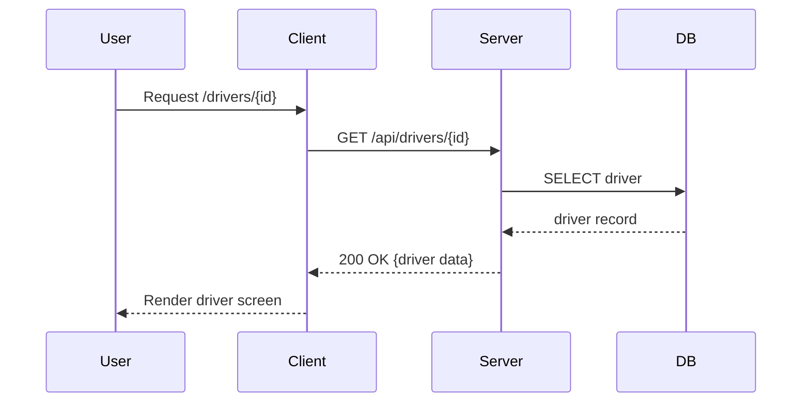


### UC-3: Read Race Configuration

**ID:** UC-3

**Title:** Read Race Configuration

**Description:** Retrieve race configuration (track, weather, lap count, rules) used for simulation and UI.

**Actors:**

- User or Simulation Service

**Triggers:**

- Client requests race configuration before a simulation or for display.

**Pre-conditions:**

- Race configuration exists for the requested event.

**Post-Conditions:**

- Configuration is returned to the caller.

**Normal Flow:**

1. Client requests configuration for event ID.
2. Server validates access and fetches race config.
3. Server returns configuration JSON.

**Alternative Flows:**

- Config missing: returns 404.

**Exceptions:**

- DB error: 503 returned.

**Acceptance Criteria:**

- Race config JSON contains track id, laps, weather, ruleset.

**Mermaid Diagram:**

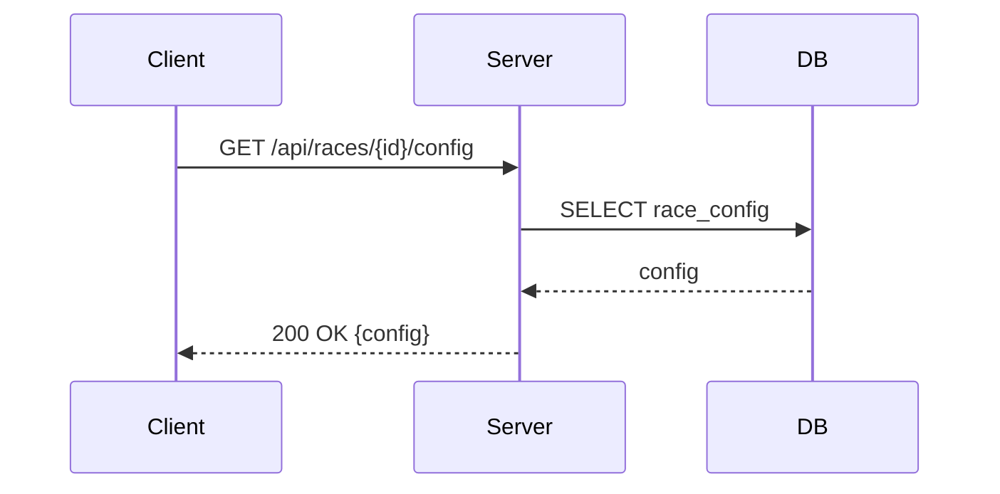


### UC-4: Create Race Result

**ID:** UC-4

**Title:** Create Race Result

**Description:** Store the outcome of a completed race in the database (positions, times, incidents).

**Actors:**

- Simulation Service (or UI submitting manual result)

**Triggers:**

- A race simulation finishes or manual result entered.

**Pre-conditions:**

- Race event exists and is in a state allowing results to be recorded.

**Post-Conditions:**

- Race result record created; related championship standings updated (UC-7) optionally queued.

**Normal Flow:**

1. Simulation posts race result payload to server.
2. Server validates schema and event state.
3. Server stores results and marks event complete.
4. Server enqueues/updates championship standing calculations.
5. Server returns acknowledgment.

**Alternative Flows:**

- Validation fails: return 400 with errors.
- Event already finalised: return 409 conflict.

**Exceptions:**

- DB write error: 500 and transaction rolled back.

**Includes:**

- Notification to interested clients (websocket/event bus).

**Extends:**

- Trigger UC-7 to update standings.

**Acceptance Criteria:**

- Valid results persist and event marked completed; duplicate submissions with identical signature are ignored.

**Mermaid Diagram:**

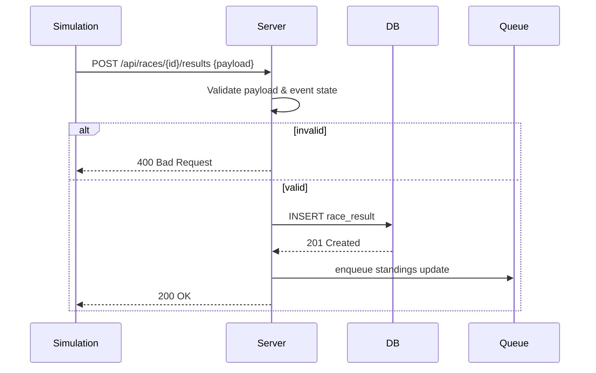


## MEDIUM Priority (Career Mode Depth)

### UC-5: Read Race Results

**ID:** UC-5

**Title:** Read Race Results

**Description:** Return stored race results for a completed event for display and historical records.

**Actors:**

- User, Standings Service

**Triggers:**

- User views previous event results or an API consumer requests results.

**Pre-conditions:**

- Results for the event exist.

**Post-Conditions:**

- Results delivered to the requester.

**Normal Flow:**

1. Client requests results by event ID.
2. Server retrieves results and related data (lap times, penalties).
3. Server returns results.

**Alternative Flows:**

- No results: 404.

**Exceptions:**

- DB read error: 503.

**Acceptance Criteria:**

- Results endpoint returns full classification for event.

**Mermaid Diagram:**

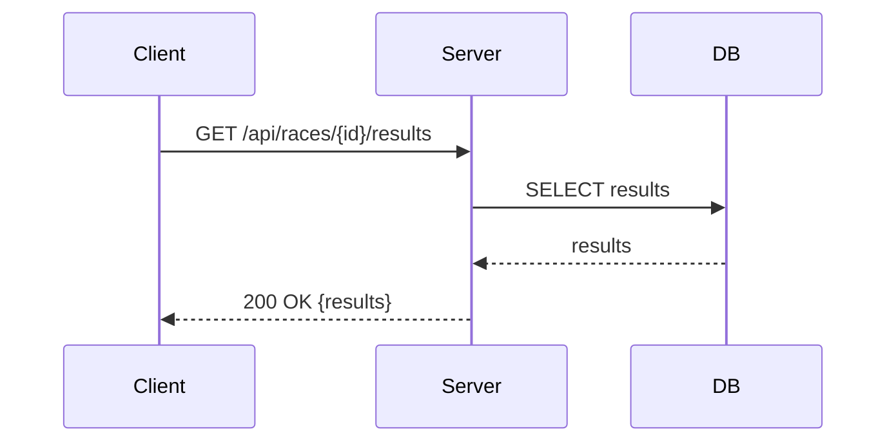


### UC-6: Read Championship Details

**ID:** UC-6

**Title:** Read Championship Details

**Description:** Return championship metadata, calendar, teams, and standings snapshot.

**Actors:**

- User, UI, External Client

**Triggers:**

- User opens championship screen.

**Pre-conditions:**

- Championship exists.

**Post-Conditions:**

- Details delivered to client.

**Normal Flow:**

1. Client requests championship by id.
2. Server aggregates metadata, calendar, and current standings.
3. Server returns the combined payload.

**Alternative Flows:**

- Championship archived: returns read-only flag.

**Acceptance Criteria:**

- Payload includes name, season, calendar, participating teams and current standings.

**Mermaid Diagram:**

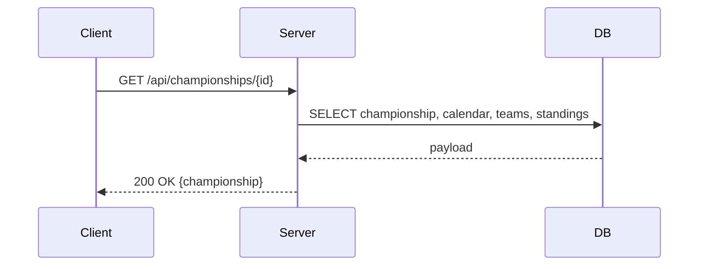


### UC-7: Update Championship Standings

**ID:** UC-7

**Title:** Update Championship Standings

**Description:** Recalculate and persist championship standings after results are created or adjusted.

**Actors:**

- Standings Service / Server

**Triggers:**

- Race result inserted/changed (UC-4) or manual correction.

**Pre-conditions:**

- Championship and related results are present.

**Post-Conditions:**

- Standings updated and stored; notifications sent.

**Normal Flow:**

1. Event triggers standings recalculation job.
2. Service gathers results and applies points rules.
3. Service persists standings and publishes update event.

**Alternative Flows:**

- Partial update: only affected rounds recomputed.

**Exceptions:**

- Points rule missing: log and abort update.

**Acceptance Criteria:**

- Standings reflect latest results and are consistent with rules.

**Mermaid Diagram:**

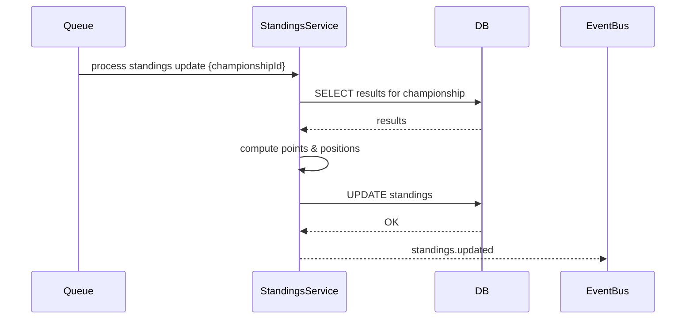


### UC-8: Create Race Event

**ID:** UC-8

**Title:** Create Race Event

**Description:** Add a race event to a championship calendar (track, date, configuration).

**Actors:**

- Game Manager (user/admin) or automated scheduler

**Triggers:**

- User creates a new event via UI or API.

**Pre-conditions:**

- Championship exists and is editable.

**Post-Conditions:**

- Event added to calendar; notifications to teams if applicable.

**Normal Flow:**

1. Admin posts new event details.
2. Server validates dates and track availability.
3. Server inserts event and returns created resource.

**Alternative Flows:**

- Date conflict: return 409 with suggested alternatives.

**Acceptance Criteria:**

- Calendar shows new event and clients can fetch it.

**Mermaid Diagram:**

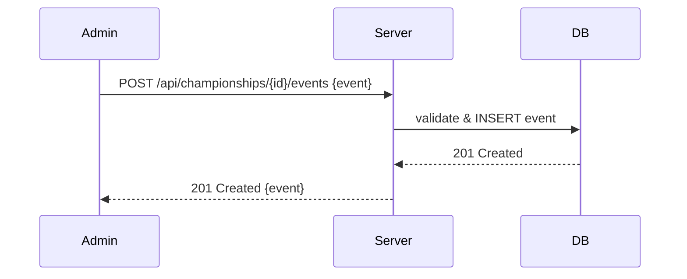


### UC-9: Read Race Schedule

**ID:** UC-9

**Title:** Read Race Schedule

**Description:** Retrieve championship calendar/schedule for UI display.

**Actors:**

- User, UI

**Triggers:**

- User opens calendar screen.

**Pre-conditions:**

- Championship or season exists.

**Post-Conditions:**

- Schedule delivered to the requester.

**Normal Flow:**

1. Client requests schedule for championship or season.
2. Server returns ordered list of events with metadata.

**Acceptance Criteria:**

- Schedule includes dates, track names, and event status.

**Mermaid Diagram:**

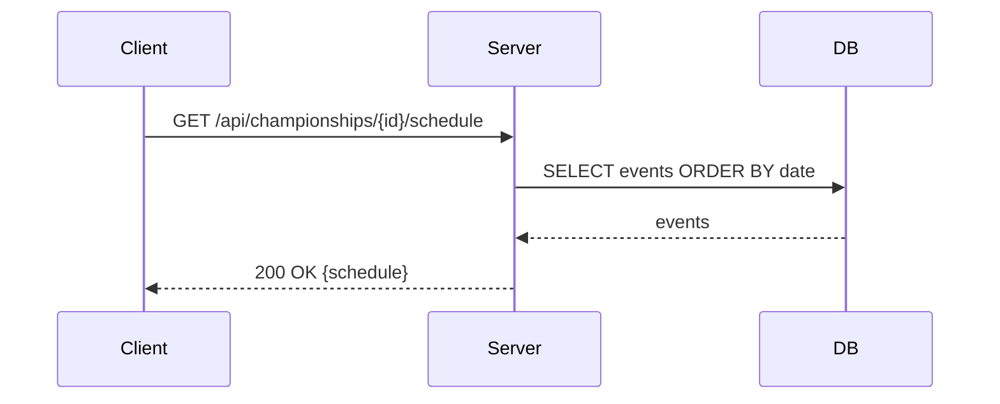


### UC-10: Update Race Status

**ID:** UC-10

**Title:** Update Race Status

**Description:** Change a race event status (scheduled, in-progress, completed, cancelled).

**Actors:**

- Simulation Service, Admin, Scheduler

**Triggers:**

- Race lifecycle events or admin action.

**Pre-conditions:**

- Event exists and caller has permissions.

**Post-Conditions:**

- Event status updated; dependent systems notified.

**Normal Flow:**

1. Service posts status update.
2. Server validates transition and updates event record.
3. Server emits event bus notification.

**Alternative Flows:**

- Invalid transition: return 400.

**Acceptance Criteria:**

- Status transitions follow defined lifecycle and notifications delivered.

**Mermaid Diagram:**

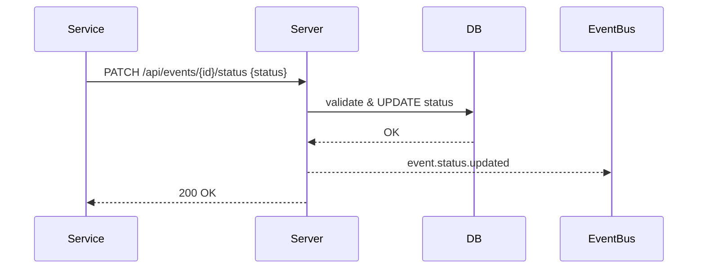


### UC-11: Create Championship

**ID:** UC-11

**Title:** Create Championship

**Description:** Create a new championship/season with base rules and empty calendar.

**Actors:**

- Admin or Game Creator

**Triggers:**

- Admin submits new championship request.

**Pre-conditions:**

- Admin authenticated and allowed to create championships.

**Post-Conditions:**

- Championship record created and available for event creation.

**Normal Flow:**

1. Admin posts championship definition (name, rules, season year).
2. Server validates rules and creates resource.
3. Server returns created championship.

**Alternative Flows:**

- Invalid rules: return 400 with errors.

**Acceptance Criteria:**

- New championship appears in list and is editable.

**Mermaid Diagram:**

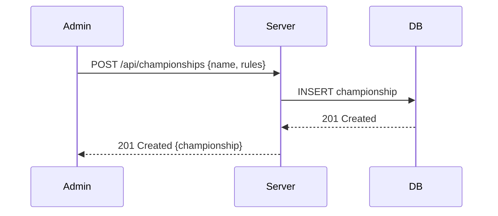


### UC-2: Read Team Details

**ID:** UC-2

**Title:** Read Team Details

**Description:** Return full team profile for team screen (budget, staff, vehicles, drivers).

**Actors:**

- User, UI

**Triggers:**

- User opens team screen.

**Pre-conditions:**

- Team exists.

**Post-Conditions:**

- Team details shown in UI.

**Normal Flow:**

1. Client requests team by ID.
2. Server fetches team, staff, budget, roster.
3. Server returns aggregated payload.

**Alternative Flows:**

- Team private or restricted: return 403.

**Acceptance Criteria:**

- Payload contains roster and core team attributes.

**Mermaid Diagram:**

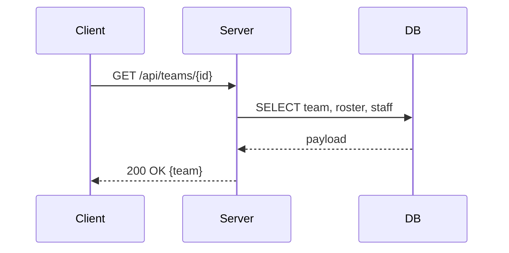


### UC-12: Create New Team

**ID:** UC-12

**Title:** Create New Team

**Description:** Create a new team record (use existing driver/staff pools or generate defaults).

**Actors:**

- User/Admin

**Triggers:**

- Admin or player creates a team.

**Pre-conditions:**

- Permissions granted; required seed data available.

**Post-Conditions:**

- Team created and assigned initial assets.

**Normal Flow:**

1. Client posts new team data.
2. Server validates and reserves required resources (budget, HQ).
3. Server inserts team and returns created entity.

**Alternative Flows:**

- Resource conflict: suggest alternatives.

**Acceptance Criteria:**

- Team created with roster or placeholders and visible in team list.

**Mermaid Diagram:**

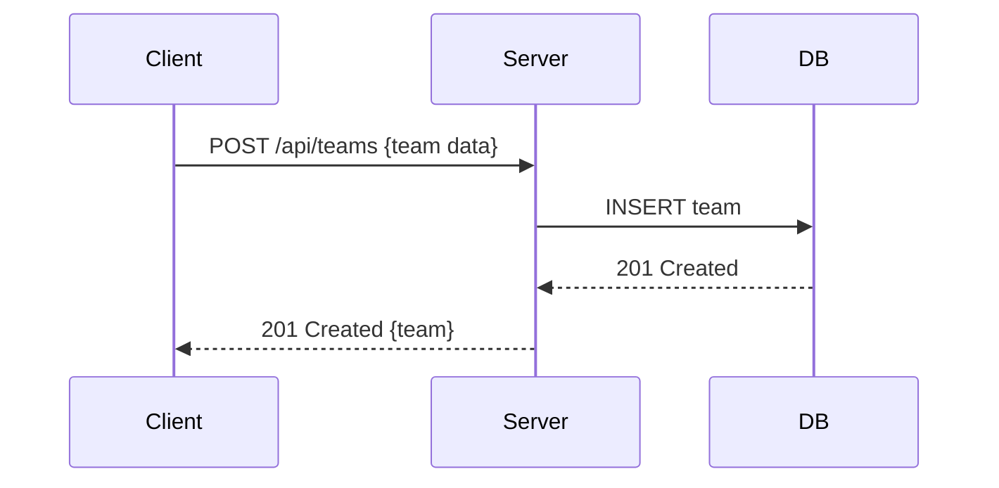


### UC-13: Read Team Details (team screen)

**ID:** UC-13

**Title:** Read Team Details (team screen)

**Description:** Similar to UC-2 but focused on the player's own team with editable fields and affordances.

**Actors:**

- Player

**Triggers:**

- Player opens their team management screen.

**Pre-conditions:**

- Player has a team.

**Post-Conditions:**

- Editable team details presented.

**Normal Flow:**

1. Client requests player's team data.
2. Server returns team, editable flags and available actions.

**Acceptance Criteria:**

- Team screen shows editable attributes and current budget.

**Mermaid Diagram:**

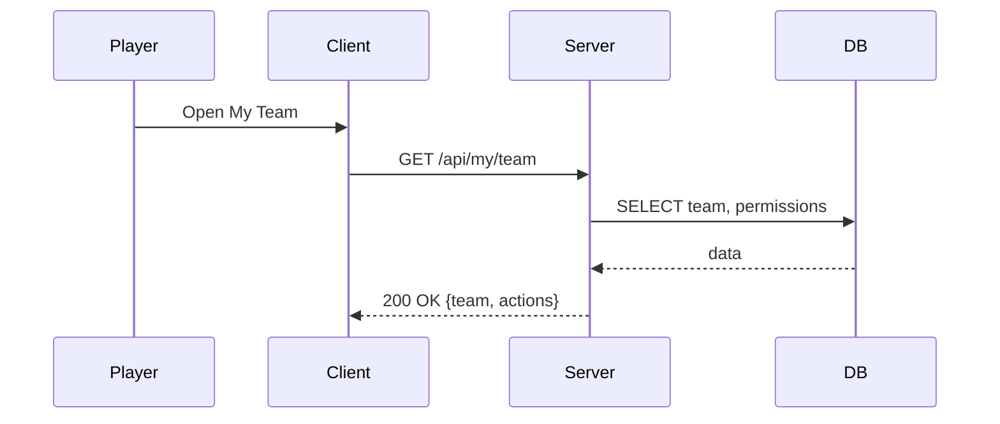


### UC-14: Update Team Attributes

**ID:** UC-14

**Title:** Update Team Attributes

**Description:** Modify team attributes (budget allocations, HQ upgrades, staff assignments).

**Actors:**

- Player/Admin

**Triggers:**

- Player performs an update via UI.

**Pre-conditions:**

- Player authorized and has sufficient budget/resources.

**Post-Conditions:**

- Team attributes updated and persisted.

**Normal Flow:**

1. Client submits attribute changes.
2. Server validates business rules and budget.
3. Server updates DB and returns updated resource.

**Alternative Flows:**

- Insufficient funds: return 422 with required amount.

**Acceptance Criteria:**

- Updates persist and are reflected in subsequent reads.

**Mermaid Diagram:**

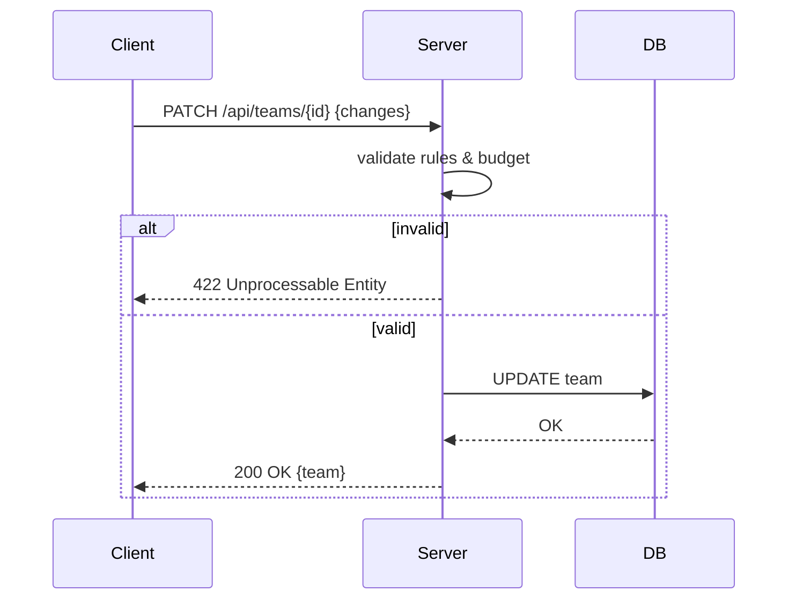


### UC-15: Read Available Drivers

**ID:** UC-15

**Title:** Read Available Drivers

**Description:** Return list of uncontracted or transfer-available drivers for recruitment screens.

**Actors:**

- Player, Team AI

**Triggers:**

- User opens driver market or filter search.

**Pre-conditions:**

- Driver pool exists.

**Post-Conditions:**

- Filtered list returned.

**Normal Flow:**

1. Client requests drivers with filters.
2. Server queries DB for available drivers and returns paginated results.

**Acceptance Criteria:**

- Response includes availability status and key attributes.

**Mermaid Diagram:**

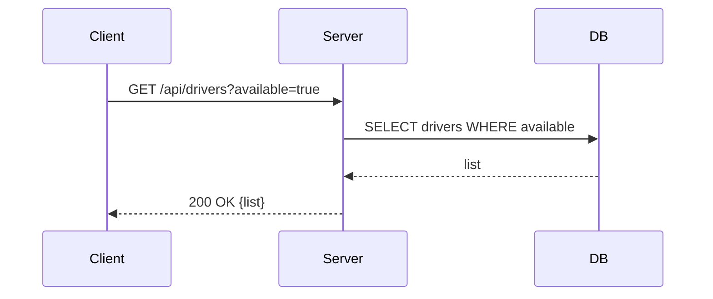


### UC-16: Update Driver Contract

**ID:** UC-16

**Title:** Update Driver Contract

**Description:** Sign, renew or terminate a driver contract and update team roster/budget.

**Actors:**

- Team Manager (player or AI), Admin

**Triggers:**

- Contract negotiation completion or admin action.

**Pre-conditions:**

- Driver and team exist; negotiation outcome determined.

**Post-Conditions:**

- Driver contract stored; team budget updated; availability toggled.

**Normal Flow:**

1. System receives contract terms for driver and team.
2. Server validates budget and contract rules.
3. Server saves contract and updates roster/budget.

**Alternative Flows:**

- Budget shortfall: return 422.

**Acceptance Criteria:**

- Contract record exists and driver shows assigned team.

**Mermaid Diagram:**

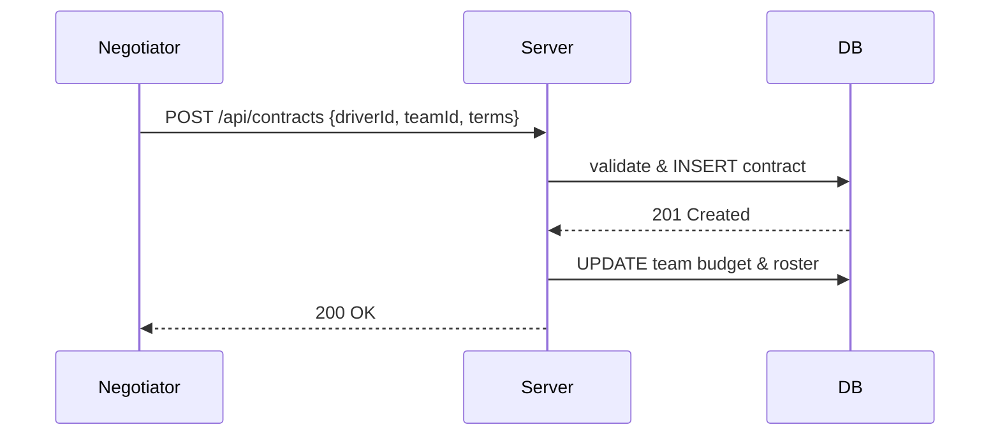


### UC-17: Read Available Staff

**ID:** UC-17

**Title:** Read Available Staff

**Description:** List staff available for hire with roles and modifiers.

**Actors:**

- Player, Team Manager

**Triggers:**

- Player opens staff hiring screen.

**Pre-conditions:**

- Staff pool exists.

**Post-Conditions:**

- List returned.

**Normal Flow:**

1. Client requests staff list with filters.
2. Server returns paginated pool with key stats and cost.

**Acceptance Criteria:**

- Includes role, cost, and performance modifiers.

**Mermaid Diagram:**

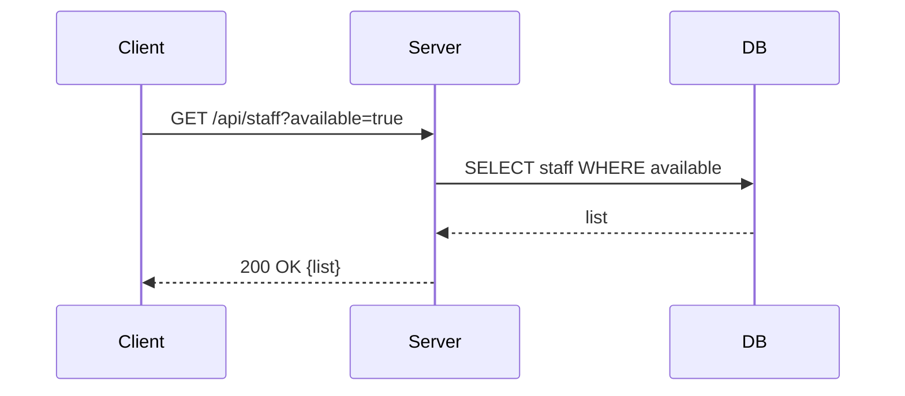


### UC-18: Update Staff Contract

**ID:** UC-18

**Title:** Update Staff Contract

**Description:** Hire, fire, or renegotiate staff contracts and persist changes to team resources.

**Actors:**

- Player, Team Manager

**Triggers:**

- Hiring action completed.

**Pre-conditions:**

- Staff profile exists and is available.

**Post-Conditions:**

- Contract recorded; team budget and staff roster updated.

**Normal Flow:**

1. Client submits staff contract terms.
2. Server validates and stores contract; updates team state.

**Acceptance Criteria:**

- Staff assigned to team and salary deducted from budget.

**Mermaid Diagram:**

```mermaid
sequenceDiagram
    Client->>Server: POST /api/staff/contracts {staffId, teamId}
    Server->>DB: INSERT contract; UPDATE team
    DB-->>Server: OK
    Server-->>Client: 200 OK
```


### UC-19: Update Driver Skills/Age (includes recycling retired drivers)

**ID:** UC-19

**Title:** Update Driver Skills/Age

**Description:** Periodic update of driver attributes (aging, skill progression/regression) and manage retirement/recycling.

**Actors:**

- Game Loop / Scheduler

**Triggers:**

- Season end or scheduled update tick.

**Pre-conditions:**

- Driver population present.

**Post-Conditions:**

- Driver attributes adjusted; retired drivers flagged and possibly recycled into pool.

**Normal Flow:**

1. Scheduler triggers attribute update job.
2. System applies progression/regression rules and increments ages.
3. Drivers surpassing retirement threshold are retired and optionally recycled.

**Alternative Flows:**

- Injury or special event triggers immediate attribute change.

**Acceptance Criteria:**

- Driver age and skills updated in DB; retired drivers moved to appropriate state.

**Mermaid Diagram:**

```mermaid
sequenceDiagram
    Scheduler->>Server: POST /api/maintenance/driver-updates
    Server->>DB: SELECT drivers
    DB-->>Server: drivers
    Server->>Server: update ages & skills; mark retirees
    Server->>DB: UPDATE drivers
    DB-->>Server: OK
    Server-->>Scheduler: 200 OK
```


### UC-20: Update Team Budget

**ID:** UC-20

**Title:** Update Team Budget

**Description:** Adjust team budget for income/expenses, sponsor payouts, race fees.

**Actors:**

- Finance System, Game Loop, Admin

**Triggers:**

- End of race, sponsor payment, purchase, or admin adjustment.

**Pre-conditions:**

- Team exists.

**Post-Conditions:**

- Team budget updated and persisted.

**Normal Flow:**

1. Transaction request to change team budget arrives.
2. Server validates transaction and updates budget atomically.
3. Server returns updated budget.

**Alternative Flows:**

- Insufficient funds for a debit: reject transaction.

**Acceptance Criteria:**

- Budget updates are atomic and consistent under concurrent access.

**Mermaid Diagram:**

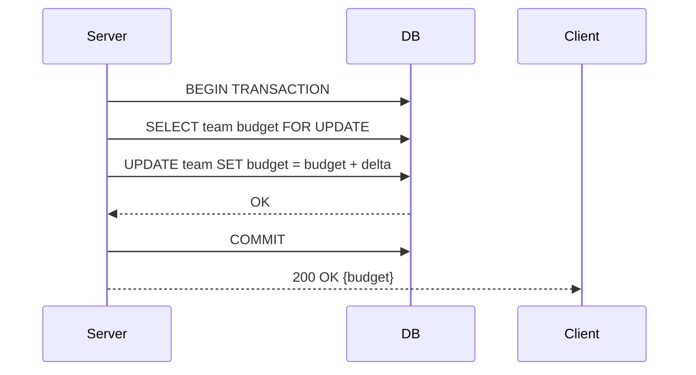


## LOW Priority (Polish & Advanced Features)

### UC-21: Create New Driver (reuse pool)

**ID:** UC-21

**Title:** Create New Driver

**Description:** Create a new driver entry (usually by recycling or generating from faker) when pool needs expansion.

**Actors:**

- Admin, System

**Triggers:**

- Manual admin action or roster expansion event.

**Pre-conditions:**

- Driver pool may be exhausted or a new generation needed.

**Post-Conditions:**

- New driver available in pool.

**Normal Flow:**

1. Admin requests new driver creation.
2. Server generates or recycles a driver and inserts record.

**Alternative Flows:**

- Duplicate name conflict: generate alternate.

**Acceptance Criteria:**

- New driver appears in available list with attributes.

**Mermaid Diagram:**

```mermaid
sequenceDiagram
    Admin->>Server: POST /api/drivers/generate
    Server->>Generator: create driver
    Generator-->>Server: driver
    Server->>DB: INSERT driver
    DB-->>Server: 201 Created
    Server-->>Admin: 201 Created {driver}
```


### UC-22: Create New Staff Member (reuse pool)

**ID:** UC-22

**Title:** Create New Staff Member

**Description:** Create or recycle staff members for hire.

**Actors:**

- Admin, System

**Triggers:**

- Pool generation or admin action.

**Post-Conditions:**

- Staff record added.

**Acceptance Criteria:**

- Staff visible in available staff list.

**Mermaid Diagram:**

```mermaid
sequenceDiagram
    Admin->>Server: POST /api/staff/generate
    Server->>Generator: create staff
    Server->>DB: INSERT staff
    Server-->>Admin: 201 Created
```


### UC-23: Delete Championship

**ID:** UC-23

**Title:** Delete Championship

**Description:** Permanently remove a championship (admin only).

**Actors:**

- Admin

**Triggers:**

- Admin confirms deletion.

**Pre-conditions:**

- Admin permission and backup policy.

**Post-Conditions:**

- Championship removed, related resources archived or deleted per policy.

**Normal Flow:**

1. Admin requests deletion.
2. Server performs integrity checks and deletes or archives resources.

**Exceptions:**

- Referential integrity prevents deletion: return 409.

**Mermaid Diagram:**

```mermaid
sequenceDiagram
    Admin->>Server: DELETE /api/championships/{id}
    Server->>DB: check references
    alt safe to delete
        Server->>DB: DELETE championship
        DB-->>Server: OK
        Server-->>Admin: 200 OK
    else blocked
        Server-->>Admin: 409 Conflict
    end
```


### UC-24: Create Custom Track

**ID:** UC-24

**Title:** Create Custom Track

**Description:** Add a custom track with characteristics for use in events.

**Actors:**

- Admin, Designer

**Triggers:**

- Track creation UI submission.

**Post-Conditions:**

- Track available for event creation.

**Acceptance Criteria:**

- Track metadata stored and usable in race config.

**Mermaid Diagram:**

```mermaid
sequenceDiagram
    Designer->>Server: POST /api/tracks {track data}
    Server->>DB: INSERT track
    DB-->>Server: 201 Created
    Server-->>Designer: 201 Created
```


### UC-25: Update Track Characteristics

**ID:** UC-25

**Title:** Update Track Characteristics

**Description:** Modify track parameters (surface, length, grip) for balancing.

**Actors:**

- Admin

**Triggers:**

- Admin submits track updates.

**Post-Conditions:**

- Track updated and future events use new parameters.

**Mermaid Diagram:**

```mermaid
sequenceDiagram
    Admin->>Server: PATCH /api/tracks/{id}
    Server->>DB: UPDATE track
    DB-->>Server: OK
    Server-->>Admin: 200 OK
```


### UC-26: Delete Track

**ID:** UC-26

**Title:** Delete Track

**Description:** Remove custom or unused tracks with checks for scheduled use.

**Actors:**

- Admin

**Triggers:**

- Admin requests deletion.

**Alternative Flows:**

- Track scheduled in future: return 409 or force archive.

**Mermaid Diagram:**

```mermaid
sequenceDiagram
    Admin->>Server: DELETE /api/tracks/{id}
    Server->>DB: check scheduled events
    alt not scheduled
        Server->>DB: DELETE track
        Server-->>Admin: 200 OK
    else scheduled
        Server-->>Admin: 409 Conflict
    end
```


### UC-27: Read Staff Performance Modifiers

**ID:** UC-27

**Title:** Read Staff Performance Modifiers

**Description:** Return computed staff modifiers used by simulation (e.g., mechanic efficiency).

**Actors:**

- Simulation, UI

**Triggers:**

- Simulation requests modifier data for a team.

**Post-Conditions:**

- Modifiers returned.

**Mermaid Diagram:**

```mermaid
sequenceDiagram
    Simulation->>Server: GET /api/teams/{id}/staff-modifiers
    Server->>DB: SELECT staff & compute modifiers
    Server-->>Simulation: 200 OK {modifiers}
```


### UC-28: Update Driver Appearance

**ID:** UC-28

**Title:** Update Driver Appearance

**Description:** Change cosmetic appearance for a driver (helmet, livery). Non-gameplay affecting.

**Actors:**

- Player

**Triggers:**

- Player saves appearance edits.

**Post-Conditions:**

- Appearance persisted and returned in reads.

**Mermaid Diagram:**

```mermaid
sequenceDiagram
    Player->>Server: PATCH /api/drivers/{id}/appearance {appearance}
    Server->>DB: UPDATE appearance
    Server-->>Player: 200 OK
```


### UC-29: Update Team Branding

**ID:** UC-29

**Title:** Update Team Branding

**Description:** Update team visual branding assets and metadata (logos, colours).

**Actors:**

- Player/Admin

**Triggers:**

- Upload branding assets and save.

**Post-Conditions:**

- Branding stored and served to UI.

**Mermaid Diagram:**

```mermaid
sequenceDiagram
    Client->>Server: PUT /api/teams/{id}/branding {assets}
    Server->>Storage: store assets
    Storage-->>Server: urls
    Server->>DB: UPDATE branding metadata
    Server-->>Client: 200 OK {branding}
```


End of use cases.
