# Use Case Diagrams — All Use Cases (UC-1 .. UC-29)

This file contains mermaid `flowchart TB` diagrams that emulate UML use-case diagrams (actors + system boundary + use cases). Paste into a Markdown viewer that supports mermaid or render with `mmdc`.

%% Styling init: set a consistent font and size for Word/print
%%{init: {"theme":"base","themeVariables":{"fontFamily":"Segoe UI, Arial, sans-serif","fontSize":"13px"}}}%%

### UC-1: Read Driver Details
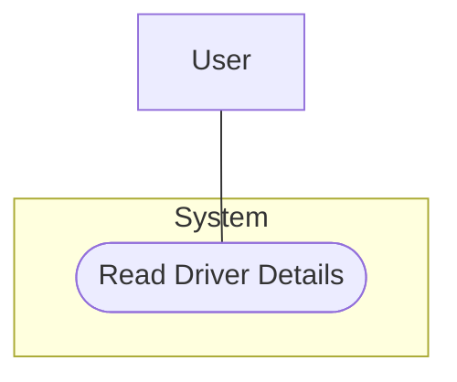

---

### UC-2: Read Team Details
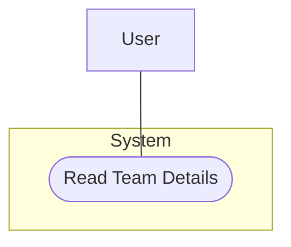

---

### UC-3: Read Race Configuration
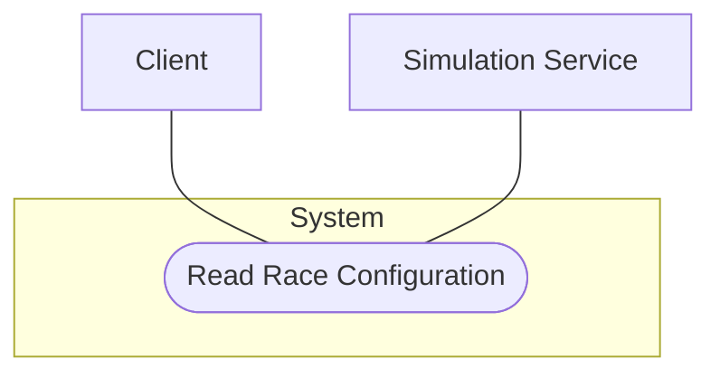

---

### UC-4: Create Race Result
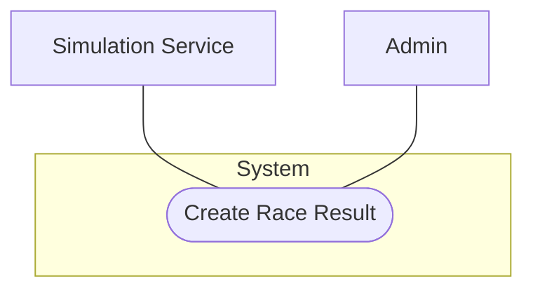

---

### UC-5: Read Race Results
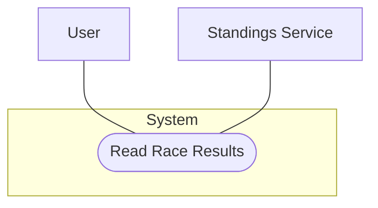

---

### UC-6: Read Championship Details
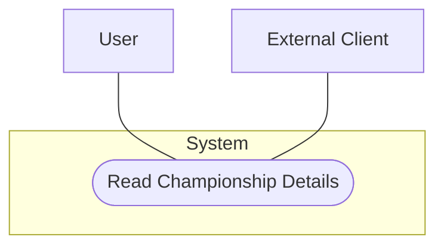

---

### UC-7: Update Championship Standings
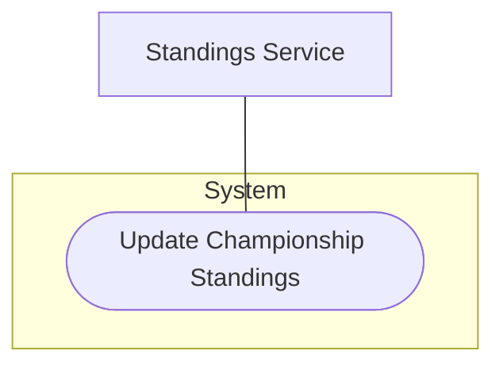

---

### UC-8: Create Race Event
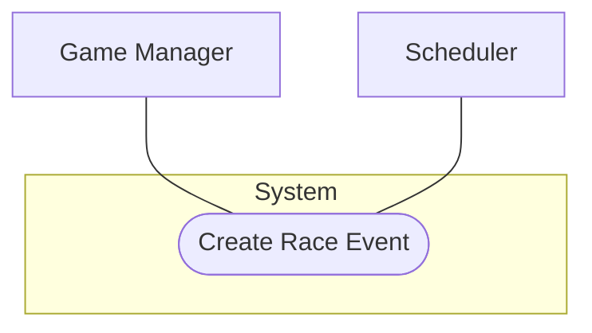

---

### UC-9: Read Race Schedule
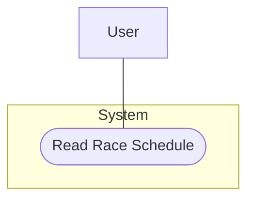

---

### UC-10: Update Race Status
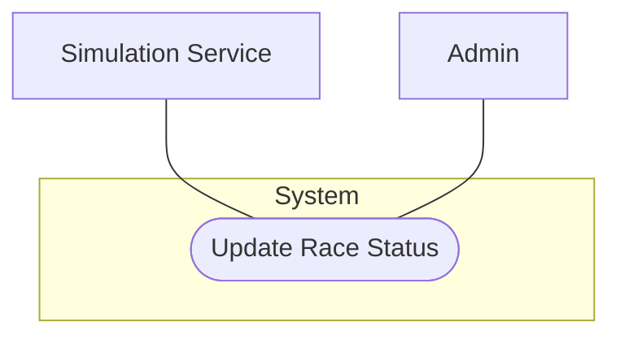

---

### UC-11: Create Championship
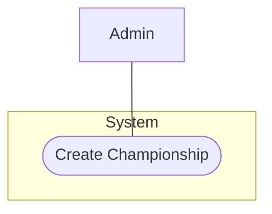

---

### UC-12: Create New Team
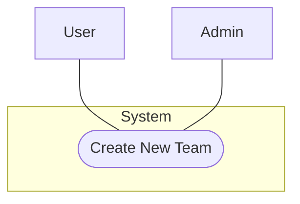

---

### UC-13: Read Team Details (player team)
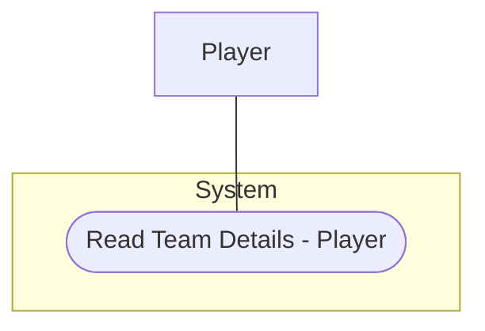

---

### UC-14: Update Team Attributes
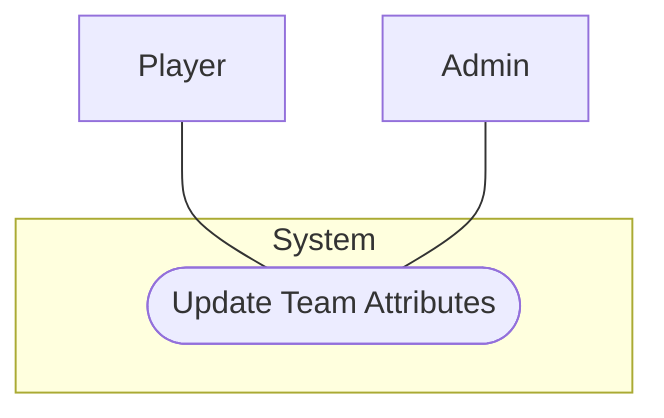

---

### UC-15: Read Available Drivers
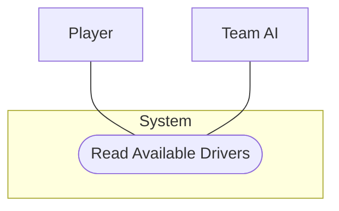

---

### UC-16: Update Driver Contract
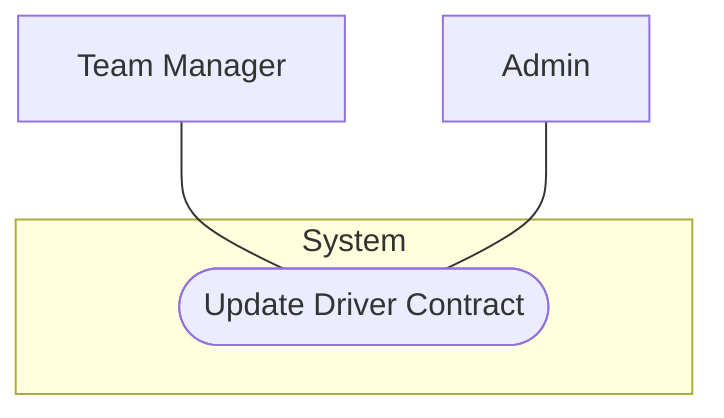

---

### UC-17: Read Available Staff
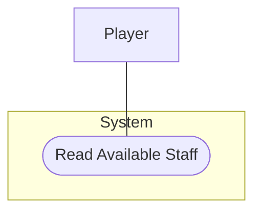

---

### UC-18: Update Staff Contract
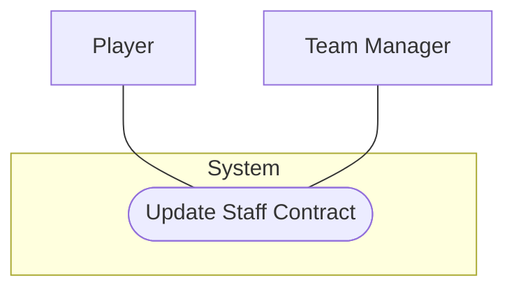

---

### UC-19: Update Driver Skills/Age
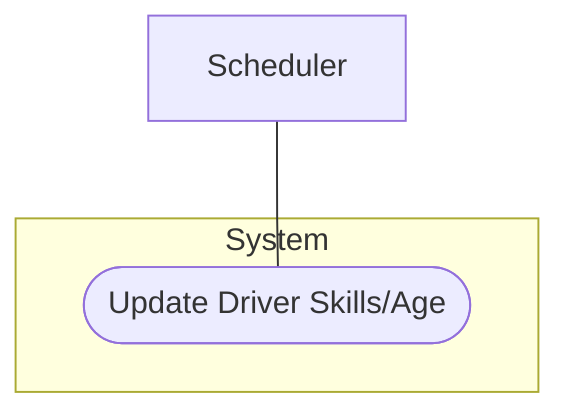

---

### UC-20: Update Team Budget
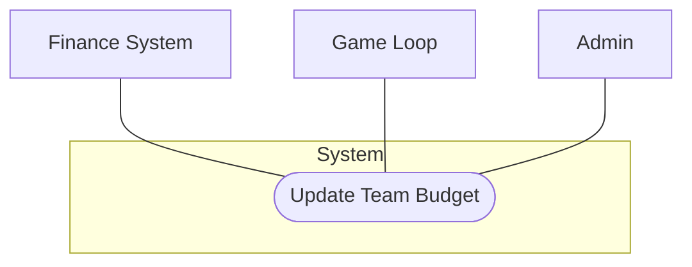

---

### UC-21: Create New Driver
```mermaid
flowchart TB
    A[Admin]
    S[System]

    subgraph System
        R([Create New Driver])
    end

    A --- R
    S --- R
```

---

### UC-22: Create New Staff Member
```mermaid
flowchart TB
    A[Admin]
    S[System]

    subgraph System
        R([Create New Staff Member])
    end

    A --- R
    S --- R
```

---

### UC-23: Delete Championship
```mermaid
flowchart TB
    A[Admin]

    subgraph System
        R([Delete Championship])
    end

    A --- R
```

---

### UC-24: Create Custom Track
```mermaid
flowchart TB
    D[Designer]
    A[Admin]

    subgraph System
        R([Create Custom Track])
    end

    D --- R
    A --- R
```

---

### UC-25: Update Track Characteristics
```mermaid
flowchart TB
    A[Admin]

    subgraph System
        R([Update Track Characteristics])
    end

    A --- R
```

---

### UC-26: Delete Track
```mermaid
flowchart TB
    A[Admin]

    subgraph System
        R([Delete Track])
    end

    A --- R
```

---

### UC-27: Read Staff Performance Modifiers
```mermaid
flowchart TB
    S[Simulation Service]
    U[UI]

    subgraph System
        R([Read Staff Performance Modifiers])
    end

    S --- R
    U --- R
```

---

### UC-28: Update Driver Appearance
```mermaid
flowchart TB
    P[Player]

    subgraph System
        R([Update Driver Appearance])
    end

    P --- R
```

---

### UC-29: Update Team Branding
```mermaid
flowchart TB
    P[Player]
    A[Admin]

    subgraph System
        R([Update Team Branding])
    end

    P --- R
    A --- R
```

---

*End of diagrams.*
