# Use Cases - Gameplay Context

This document presents the same CRUD use cases from `All_Use_Cases_Detailed.md` but frames them within the context of gameplay features and player actions. Each use case is explained as a database operation that **enables** specific gameplay mechanics.

---

## HIGH PRIORITY - Core Race Simulation

### UC-1: Read Driver Details

**Gameplay Purpose:** Load driver attributes for race simulation

**When This Happens:**

- Player starts a race weekend
- Simulation engine initializes race participants
- AI teams evaluate driver performance
- Player views driver comparison screens

**Enables Gameplay Features:**

- Realistic race outcomes based on 56 driver attributes
- Multi-discipline racing (rally_aptitude, endurance_aptitude, etc.)
- Driver skill progression visible in career mode
- Strategic driver hiring decisions

**Data Flow:**

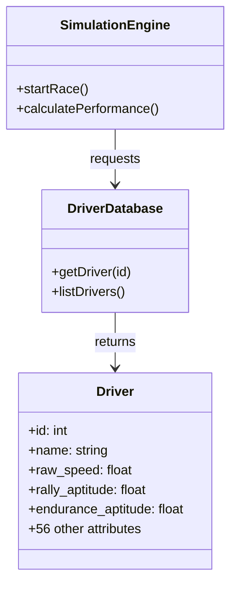

---

### UC-2: Read Race Configuration

**Gameplay Purpose:** Load track and event settings for race execution

**When This Happens:**

- Player enters a race weekend
- Championship calendar displays upcoming events
- AI teams prepare race strategy
- Simulation engine configures race parameters

**Enables Gameplay Features:**

- Discipline-specific race formats (rally stages, drag brackets, endurance duration)
- Track characteristics affect strategy (length, surface, weather)
- Event rules determine scoring (points system, qualifying format)
- Different race types per championship

**Data Flow:**

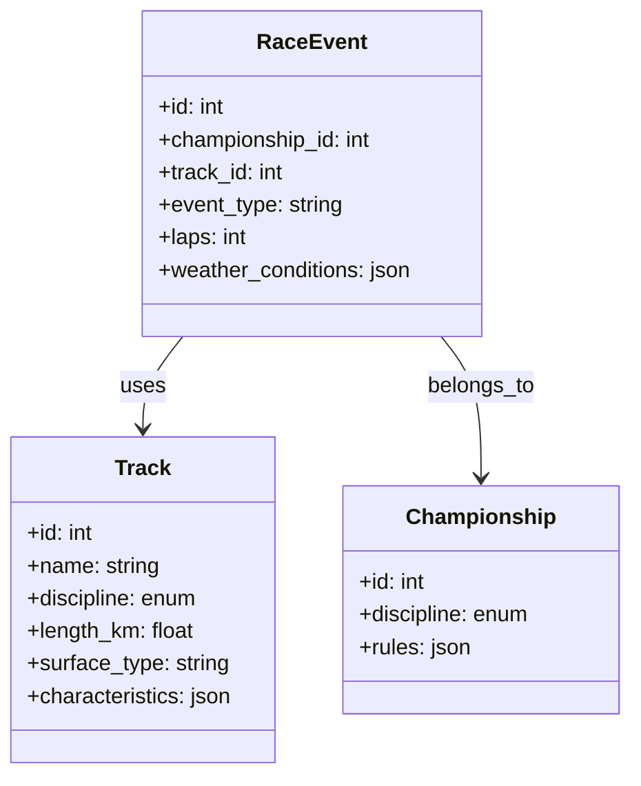

---

### UC-3: Create Race Result

**Gameplay Purpose:** Save race outcomes and update championship standings

**When This Happens:**

- Race simulation completes
- Player finishes a race weekend
- Championship standings need updating
- Historical records are being created

**Enables Gameplay Features:**

- Career progression tracking (wins, podiums, points)
- Championship standings calculation
- Team performance evaluation
- Driver skill progression based on results
- Financial rewards (prize money)

**Data Flow:**

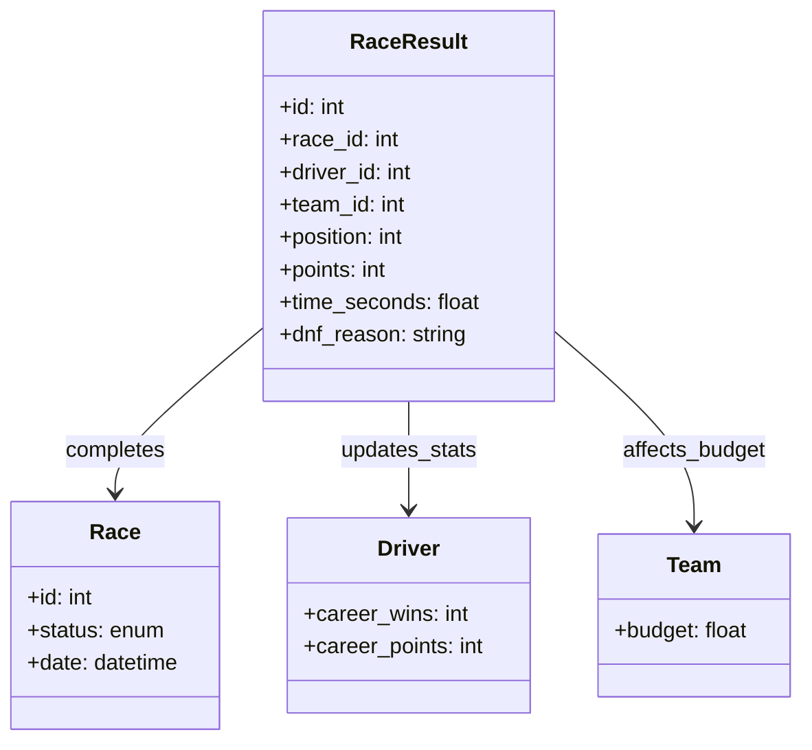

---

## MEDIUM PRIORITY - Career Mode & Management

### UC-4: Read Race Results

**Gameplay Purpose:** Display historical race outcomes and statistics

**When This Happens:**

- Player views past race results
- Championship standings screen loads
- AI evaluates past performance
- Player reviews career history

**Enables Gameplay Features:**

- Historical record tracking
- Performance trend analysis
- Rivalry development (driver vs driver comparisons)
- Season recap and statistics

**Data Flow:**

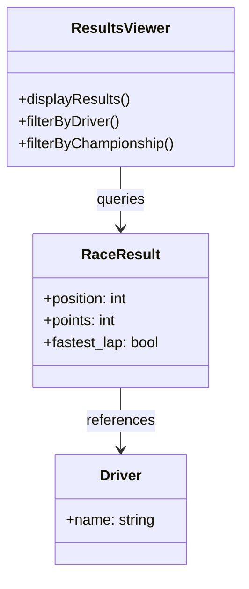

---

### UC-5: Read Championship Details

**Gameplay Purpose:** Display championship information and standings

**When This Happens:**

- Player opens championship screen
- Career mode shows available series
- AI teams evaluate championship competitiveness
- Player selects which championship to compete in

**Enables Gameplay Features:**

- **Multi-discipline racing** (7 different disciplines in one game)
- Season calendar visualization
- Current standings display
- Championship-specific rules (points system, race formats)
- Historical championship winners

**Data Flow:**

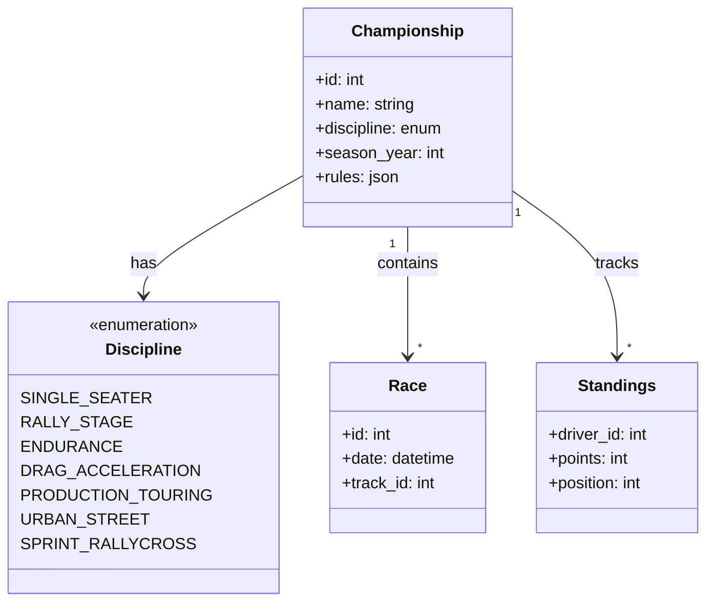

---

### UC-6: Update Championship Standings

**Gameplay Purpose:** Recalculate points after race completion

**When This Happens:**

- Race results are finalized
- Player completes a race weekend
- Season progresses
- Championship winner is determined

**Enables Gameplay Features:**

- Live championship battles
- Season-long narrative (championship fight)
- Performance pressure (position in standings affects AI behavior)
- Career progression milestones

**Data Flow:**

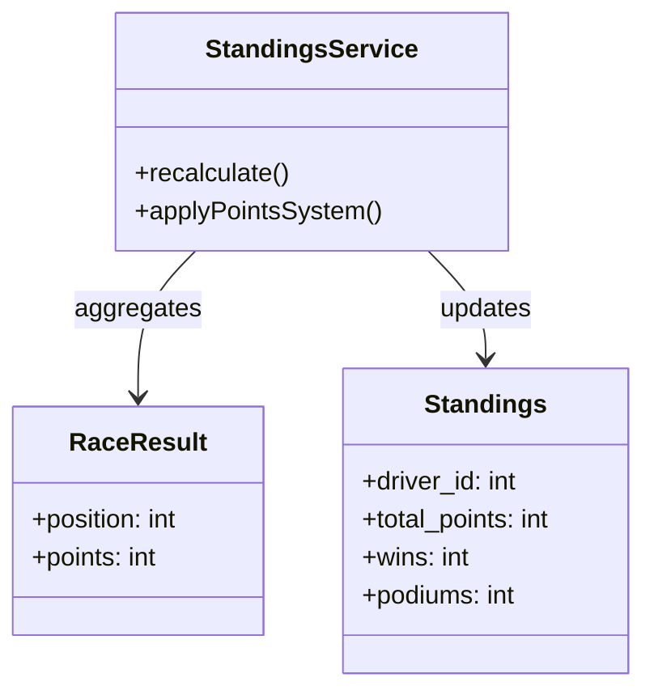

---

### UC-7: Create Race Event

**Gameplay Purpose:** Add races to championship calendar

**When This Happens:**

- Season initialization creates calendar
- Custom championship creation
- AI schedules additional events
- Player adds exhibition races

**Enables Gameplay Features:**

- **Discipline-specific event types** (rally stages vs circuit races vs drag brackets)
- Season structure customization
- Track rotation across championships
- Historical venue tracking

**Data Flow:**

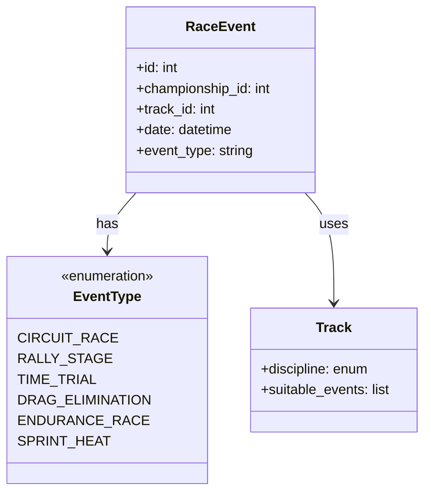

---

### UC-8: Read Race Schedule

**Gameplay Purpose:** Display upcoming and past races

**When This Happens:**

- Player opens calendar screen
- Career mode shows next race
- AI plans strategy for upcoming events
- Player prepares team for next weekend

**Enables Gameplay Features:**

- Season planning and preparation
- Travel logistics (optional future feature)
- Strategic resource allocation
- Time-based progression

**Data Flow:**

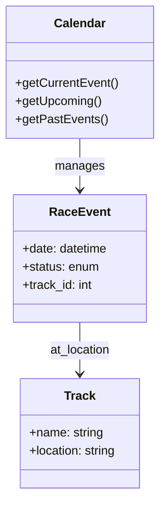

---

### UC-9: Update Race Status

**Gameplay Purpose:** Track race lifecycle (scheduled → in-progress → completed)

**When This Happens:**

- Player starts a race weekend
- Race simulation begins
- Race completes
- Event is cancelled (optional)

**Enables Gameplay Features:**

- Race weekend progression
- Save game state during weekends
- Historical event tracking
- AI event participation

**Data Flow:**

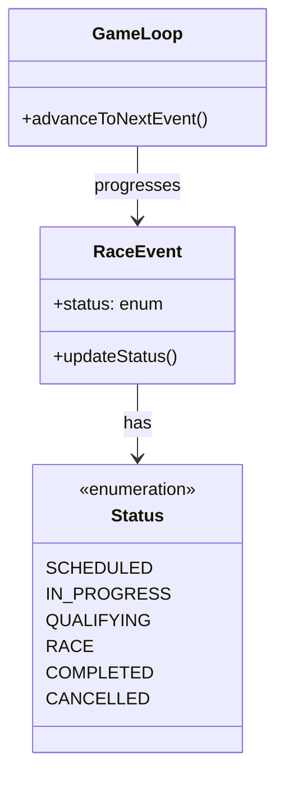

---

### UC-10: Create Championship

**Gameplay Purpose:** Initialize new racing season or custom series

**When This Happens:**

- New game career mode starts
- Season rollover creates next year
- Player creates custom championship
- AI generates parallel championships

**Enables Gameplay Features:**

- **Multi-discipline career** (compete in different racing types)
- Season-to-season progression
- Custom championship creation
- Parallel leagues (player in one, AI in others)

**Data Flow:**

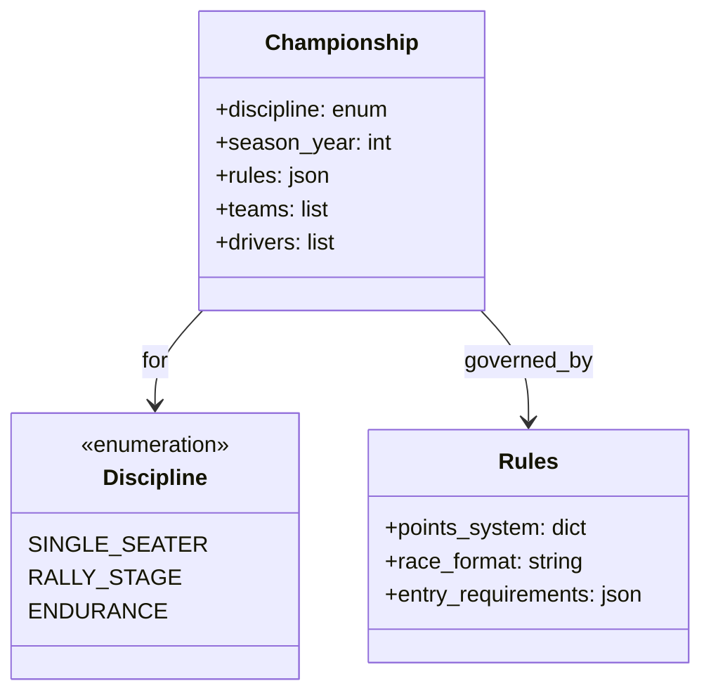

---

### UC-11: Read Team Details

**Gameplay Purpose:** Display team information for gameplay decisions

**When This Happens:**

- Player views team roster
- Driver hiring screen shows team comparison
- AI evaluates team competitiveness
- Performance analysis screens

**Enables Gameplay Features:**

- Team management decisions
- Budget tracking
- Staff roster display
- Team performance comparison
- Competitive hierarchy

**Data Flow:**

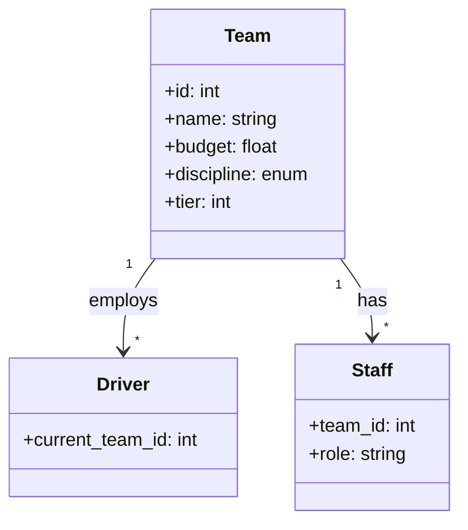

---

### UC-12: Create New Team

**Gameplay Purpose:** Initialize player's career or expansion team

**When This Happens:**

- Career mode starts
- Player creates custom team
- AI generates new teams for expansion
- Team promotion from lower tier

**Enables Gameplay Features:**

- Career mode initialization
- Team customization
- Dynamic team roster (teams can enter/exit)
- Multiple save file support

**Data Flow:**

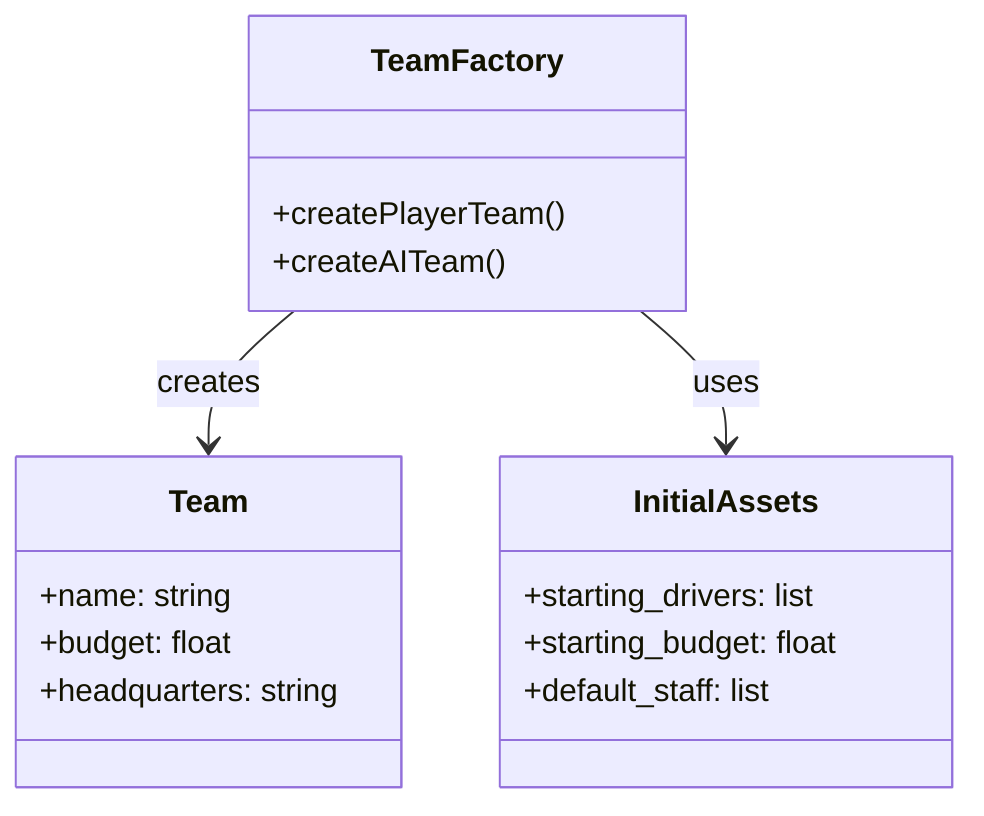

---

### UC-13: Read Team Details (Player Team)

**Gameplay Purpose:** Display player's own team for management screen

**When This Happens:**

- Player opens "My Team" screen
- Budget allocation interface loads
- Staff management screen displays
- Vehicle development screen shows resources

**Enables Gameplay Features:**

- Team management hub
- Budget allocation decisions
- Staff hiring interface
- Development priority setting

**Data Flow:**

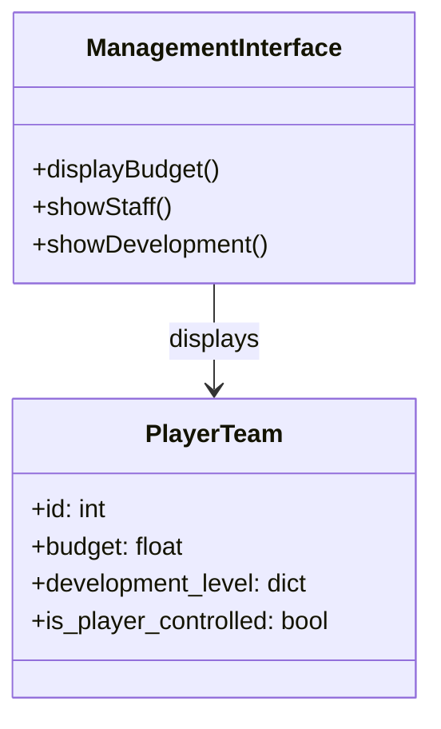

---

### UC-14: Update Team Attributes

**Gameplay Purpose:** Modify team properties based on player decisions

**When This Happens:**

- Player allocates development budget
- Season end financial updates
- Facility upgrades complete
- Sponsorship deals signed

**Enables Gameplay Features:**

- Budget management gameplay
- Team progression over seasons
- Strategic resource allocation
- Performance improvement investment

**Data Flow:**

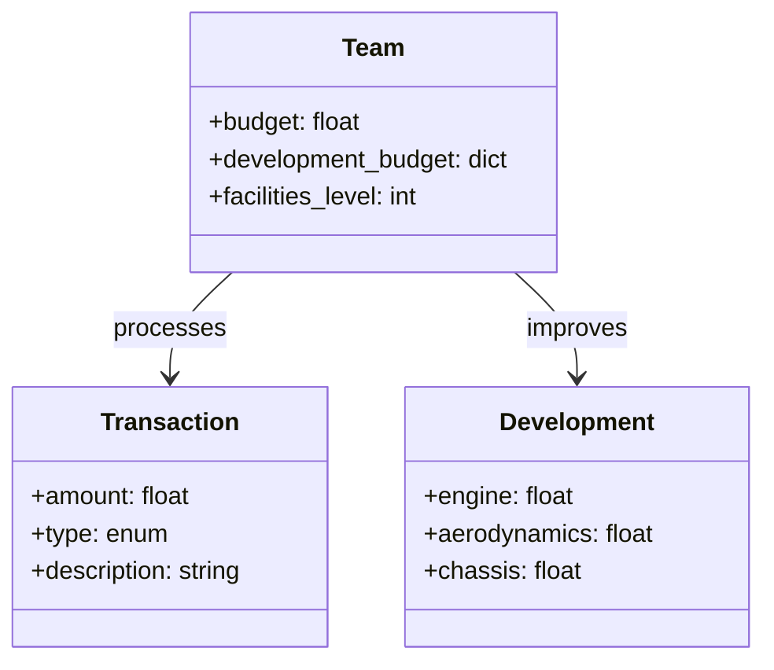

---

### UC-15: Read Available Drivers

**Gameplay Purpose:** Display driver market for hiring decisions

**When This Happens:**

- Player opens driver market screen
- Contract negotiation season begins
- AI teams evaluate hiring options
- Player scouts talent

**Enables Gameplay Features:**

- Driver hiring gameplay
- Transfer market dynamics
- Driver comparison and scouting
- Contract negotiation preparation

**Data Flow:**

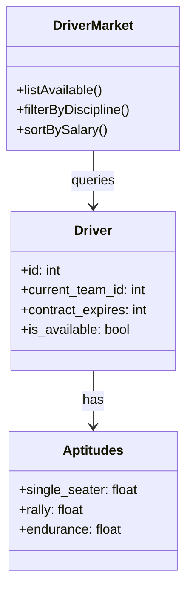

---

### UC-16: Update Driver Contract

**Gameplay Purpose:** Execute driver hiring/firing decisions

**When This Happens:**

- Player signs a driver
- Driver contract expires
- Player fires underperforming driver
- AI teams make roster changes

**Enables Gameplay Features:**

- Roster management
- Budget impact (salary commitments)
- Team composition strategy
- Career mode narrative (driver loyalty/betrayal)

**Data Flow:**

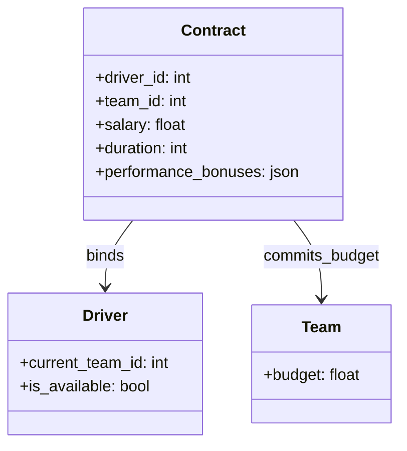

---

### UC-17: Read Available Staff

**Gameplay Purpose:** Display staff market for hiring decisions

**When This Happens:**

- Player opens staff hiring screen
- Team needs specialist (engineer, strategist)
- AI evaluates staff quality
- Player scouts technical talent

**Enables Gameplay Features:**

- Staff hiring decisions
- **Role-specific specialists** (Aerodynamicist, Race Strategist, etc.)
- Performance modifier stacking
- Budget allocation strategy

**Data Flow:**

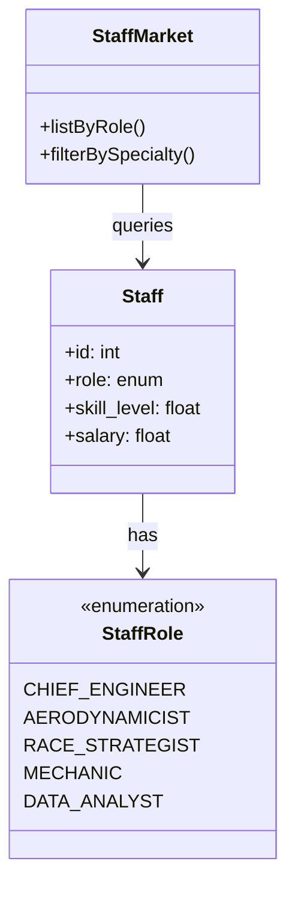

---

### UC-18: Update Staff Contract

**Gameplay Purpose:** Execute staff hiring/firing decisions

**When This Happens:**

- Player hires engineer
- Staff member fired
- Staff promoted internally
- Salary renegotiation

**Enables Gameplay Features:**

- Staff management gameplay
- Technical team building
- Performance improvement through expertise
- Budget management

**Data Flow:**

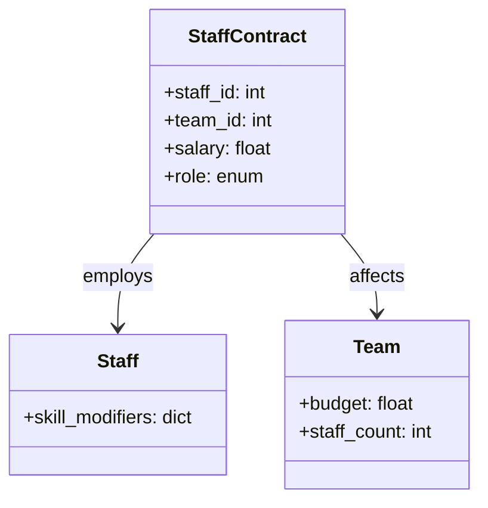

---

### UC-19: Update Driver Skills/Age

**Gameplay Purpose:** Simulate driver progression/regression over time

**When This Happens:**

- Season ends
- Driver gains experience
- Driver ages and skills decline
- Driver retires and is recycled

**Enables Gameplay Features:**

- **Long-term career progression**
- Driver aging and retirement
- Rookie development
- Dynamic driver pool (retired drivers recycled as rookies)

**Data Flow:**

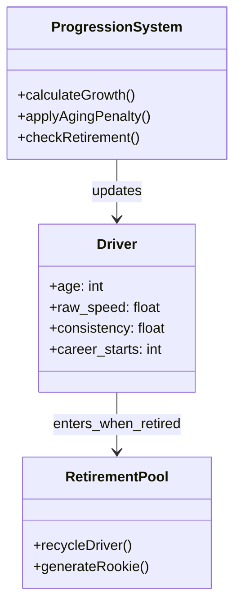

---

### UC-20: Update Team Budget

**Gameplay Purpose:** Process financial transactions affecting team resources

**When This Happens:**

- Race prize money awarded
- Sponsor payments received
- Staff/driver salaries paid
- Development costs deducted
- Season end accounting

**Enables Gameplay Features:**

- Financial management gameplay
- Budget constraints create strategic choices
- Sponsorship importance
- Economic consequences of performance

**Data Flow:**

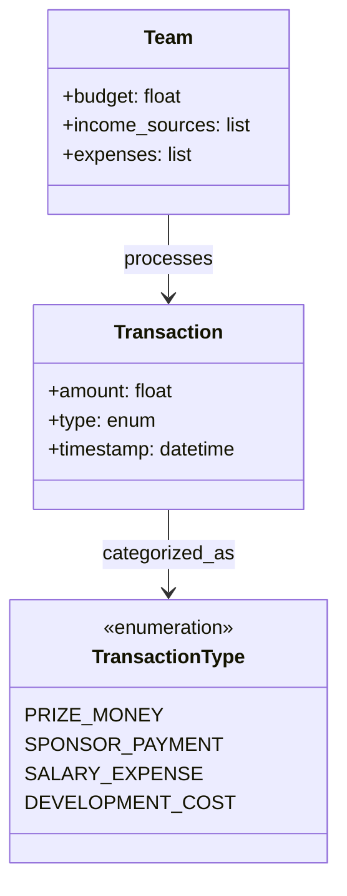

---

## LOW PRIORITY - Polish & Advanced Features

### UC-21: Create New Driver

**Gameplay Purpose:** Expand driver pool when needed

**When This Happens:**

- Driver pool depletes
- Admin generates rookies
- Expansion of championships
- Manual roster expansion

**Enables Gameplay Features:**

- Dynamic driver generation
- Infinite career mode longevity
- Custom driver creation (future)

**Data Flow:**

```mermaid
classDiagram
    class DriverGenerator {
        +generate()
        +recycle()
    }
    class Driver {
        +56_attributes: float
        +is_generated: bool
    }
    DriverGenerator --> Driver : creates
```

---

### UC-22: Create New Staff Member

**Gameplay Purpose:** Expand staff pool when needed

**When This Happens:**

- Staff pool depletes
- New roles added
- Championship expansion

**Enables Gameplay Features:**

- Dynamic staff availability
- Role diversity

**Data Flow:**

```mermaid
classDiagram
    class StaffGenerator {
        +generateStaff()
    }
    class Staff {
        +role: enum
        +attributes: dict
    }
    StaffGenerator --> Staff : creates
```

---

### UC-23: Delete Championship

**Gameplay Purpose:** Remove old/completed championships

**When This Happens:**

- Save game cleanup
- Historical archive management
- Admin maintenance

**Enables Gameplay Features:**

- Save file management
- Database maintenance

---

### UC-24: Create Custom Track

**Gameplay Purpose:** Add player-created tracks

**When This Happens:**

- Player creates custom venue
- Modding support
- Fictional circuit creation

**Enables Gameplay Features:**

- Track customization
- Community content (future)

**Data Flow:**

```mermaid
classDiagram
    class Track {
        +name: string
        +length_km: float
        +discipline: enum
        +characteristics: json
    }
    class TrackCreator {
        +defineLayout()
        +setCharacteristics()
    }
    TrackCreator --> Track : creates
```

---

### UC-25: Update Track Characteristics

**Gameplay Purpose:** Modify track properties for balance

**When This Happens:**

- Track rebalancing
- Surface updates
- Weather pattern changes

**Enables Gameplay Features:**

- Track evolution over seasons
- Balance adjustments

---

### UC-26: Delete Track

**Gameplay Purpose:** Remove unused tracks

**When This Happens:**

- Database cleanup
- Track rotation
- Decommissioned venues

**Enables Gameplay Features:**

- Dynamic track roster

---

### UC-27: Read Staff Performance Modifiers

**Gameplay Purpose:** Calculate staff impact on team performance

**When This Happens:**

- Race simulation initializes
- Team performance calculation
- Development speed calculated

**Enables Gameplay Features:**

- Staff actually affects results
- Hiring decisions have mechanical impact

**Data Flow:**

```mermaid
classDiagram
    class Staff {
        +skill_level: float
        +role: enum
    }
    class PerformanceModifier {
        +calculateBonus()
    }
    class TeamPerformance {
        +base_performance: float
        +staff_bonus: float
    }
    Staff --> PerformanceModifier : provides
    PerformanceModifier --> TeamPerformance : improves
```

---

### UC-28: Update Driver Appearance

**Gameplay Purpose:** Customize driver cosmetics

**When This Happens:**

- Player customizes helmet/suit
- Career mode personalization

**Enables Gameplay Features:**

- Visual personalization
- Player expression

---

### UC-29: Update Team Branding

**Gameplay Purpose:** Customize team visuals

**When This Happens:**

- Player designs livery
- Team rebranding
- Sponsor integration

**Enables Gameplay Features:**

- Visual identity
- Team personalization

---

## Summary: Database Operations Enable Gameplay

This document demonstrates how every CRUD operation directly supports gameplay features:

### Core Simulation (HIGH Priority)

- **UC-1, UC-2, UC-3**: Enable race execution with realistic outcomes
- Database stores 56 driver attributes and discipline aptitudes
- Track configurations support 7 racing disciplines

### Championship System (MEDIUM Priority)

- **UC-5, UC-6, UC-7, UC-8, UC-9, UC-10**: Enable season progression
- `discipline` field in Championships table supports multi-discipline racing
- Event types support discipline-specific race formats

### Team Management (MEDIUM Priority)

- **UC-11-14, UC-20**: Enable team building and resource management
- Budget system creates strategic constraints
- Development progression over multiple seasons

### Personnel Management (MEDIUM Priority)

- **UC-15-19**: Enable driver/staff hiring and progression
- Discipline aptitudes enable cross-discipline career paths
- Aging system creates long-term roster dynamics

### Customization (LOW Priority)

- **UC-21-29**: Enable content creation and personalization
- Track creation supports custom championships
- Staff/driver generation ensures infinite content

**Key Insight:** The database schema's design (discipline enums, aptitude attributes, event types) allows a single set of CRUD operations to support highly varied gameplay across 7 racing disciplines without requiring separate implementations for each.
