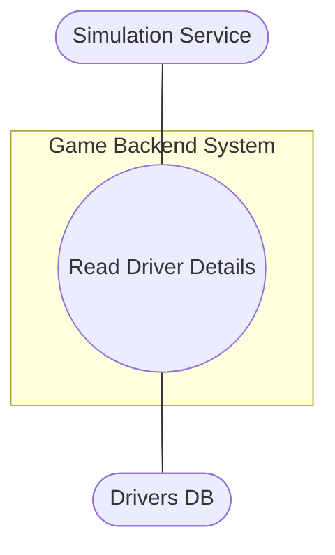

**UC-01: Read Driver Details**

Scope
Provide the simulation service with a complete driver profile and runtime status required to instantiate the driver in a race simulation.

Description
How the game backend returns a driver's attributes, contract/team association and runtime state (injury/fatigue/availability) so the Simulation Service can include the driver in race initialisation and performance calculations.

Use Case Diagram

Flow Description

Precondition
The system is in initialisation mode for a race; the driver record exists and the driver is eligible for selection.

Activation
This use case starts when the Simulation Service requests a driver's data for race setup.

Main flow

1. The system identifies the requested driverId and validates its format.
2. The Simulation Service requests the driver's profile from the backend (see A1).
3. The system retrieves the driver record and runtime state from the database (see E1).
4. The Simulation Service receives the payload and initialises the driver object for the race.

Alternate flow
A1 : Driver retrieval request (internal API)

1. The Simulation Service calls the internal GET /internal/drivers/{driverId} endpoint.
2. The use case continues at position 3 of the main flow.

Exceptional flow
E1 : Data store failure or missing related data 4. The system logs the error and returns an error code to the Simulation Service. 5. The Simulation Service attempts to use a reserve driver or aborts the roster slot. 6. The use case continues at position 4 of the main flow if a substitute was selected.

Termination
The system presents the initialised driver object to the Simulation Service and the race proceeds to the next initialisation step.

Post condition
The system goes into a wait state until the next simulation initialisation request.
