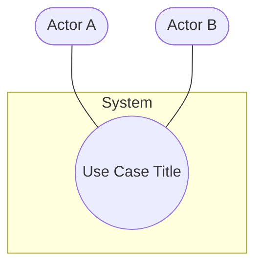

**Use Case Template (UML-ordered)**

Scope
The scope of this use case is to …….

Description
This use case describes the ………..

Use Case Diagram
Diagram should highlight actors and uses cases (an example mermaid block that emulates a UML use-case diagram):

Flow Description

Precondition
The system is in initialisation mode……..

Activation
This use case starts when an <Actor>…………

Main flow
1. The system identifies the ……….
2. The <Actor> …………...(See A1)
3. The system …………..(See E1)
4. The <Actor> ………….

Alternate flow
A1 : <title of A1>
1. The system …………..
2. The <Actor> ………….
3. The use case continues at position 3 of the main flow

Exceptional flow
E1 : <title of E1>
4. The system …………..
5. The <Actor> ………….
6. The use case continues at position 4 of the main flow

Termination
The system presents the next ……….

Post condition
The system goes into a wait state
