````markdown
# Use Case Diagrams

This file contains the mermaid diagrams for each use case. Diagrams were moved from `All_Use_Cases_Detailed.md` to keep the primary document focused on textual use-case descriptions.

---

## UC-1: Read Driver Details

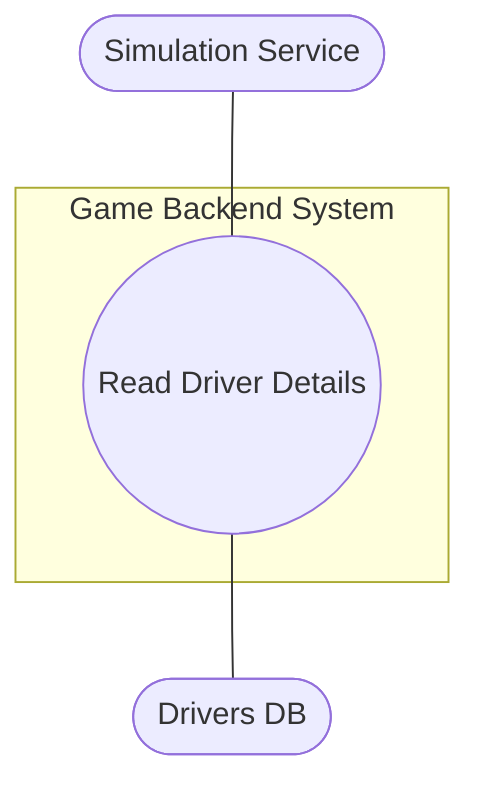

---

## UC-2: Read Race Configuration

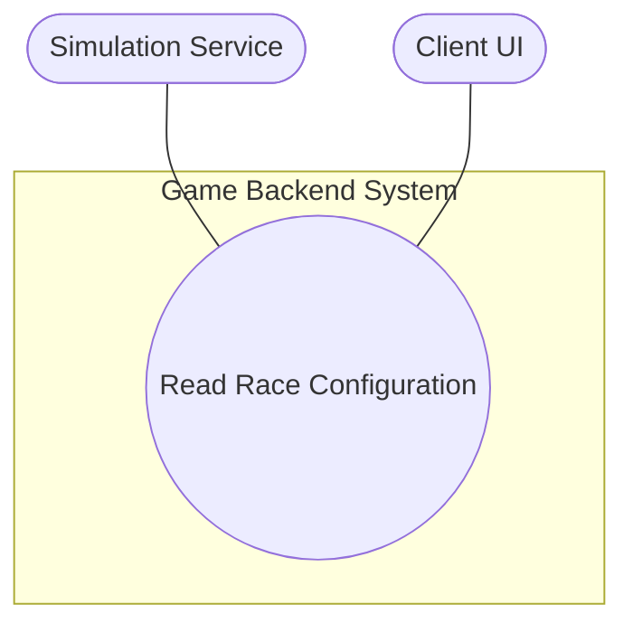

---

## UC-3: Create Race Result

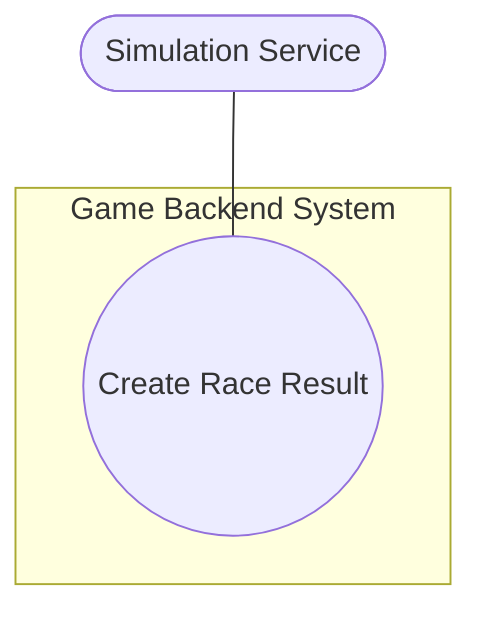

---

## UC-4: Read Race Results


---

## UC-5: Read Championship Details

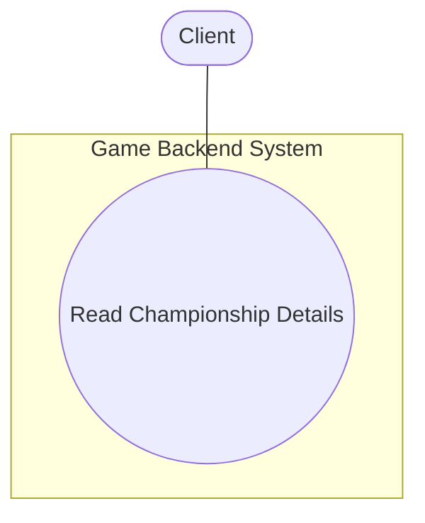

---

## UC-6: Update Championship Standings

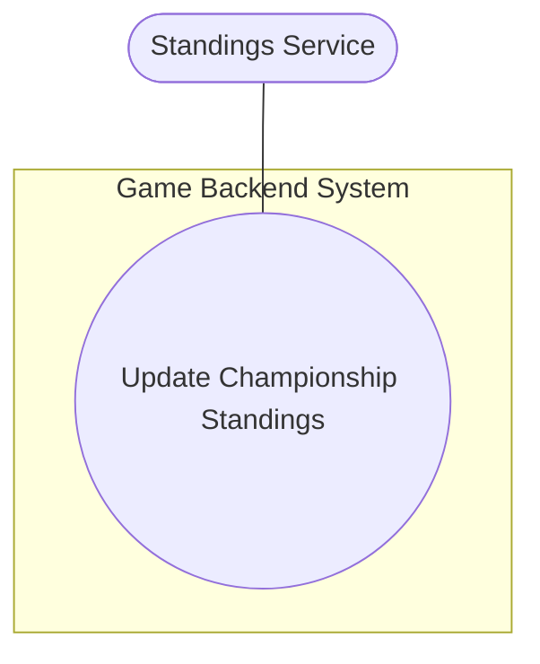

---

## UC-7: Create Race Event

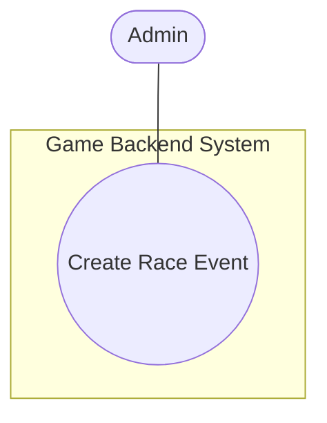

---

## UC-8: Read Race Schedule

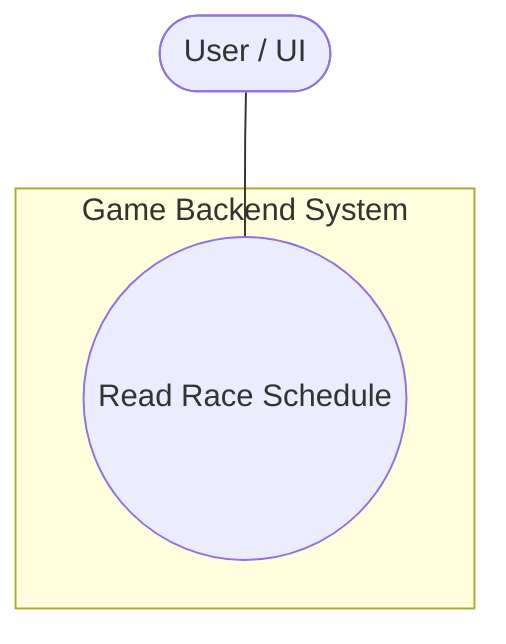

---

## UC-9: Update Race Status

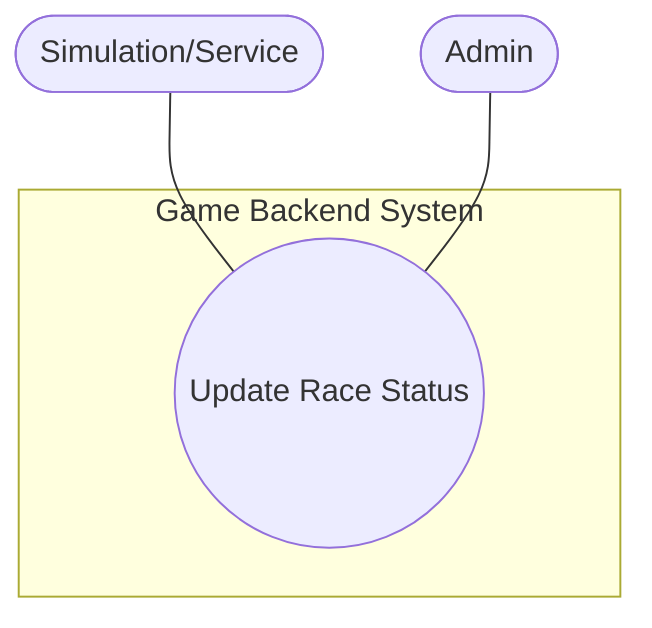

---

## UC-10: Create Championship

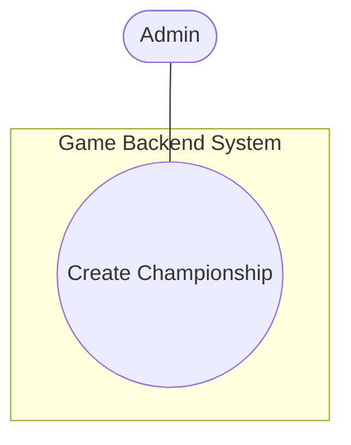

---

## UC-11: Read Team Details

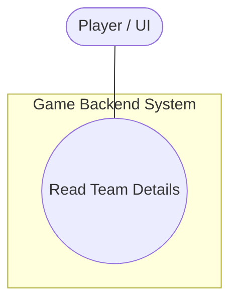

---

## UC-12: Create New Team

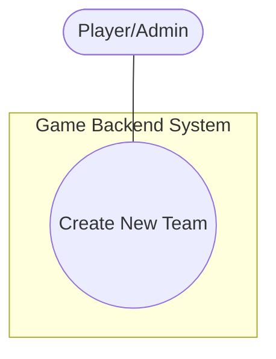

---

## UC-13: Read Team Details (player team)

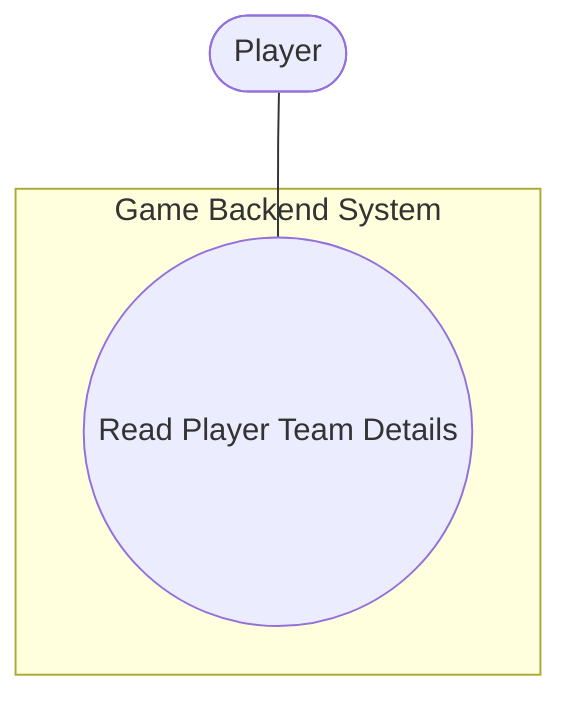

---

## UC-14: Update Team Attributes

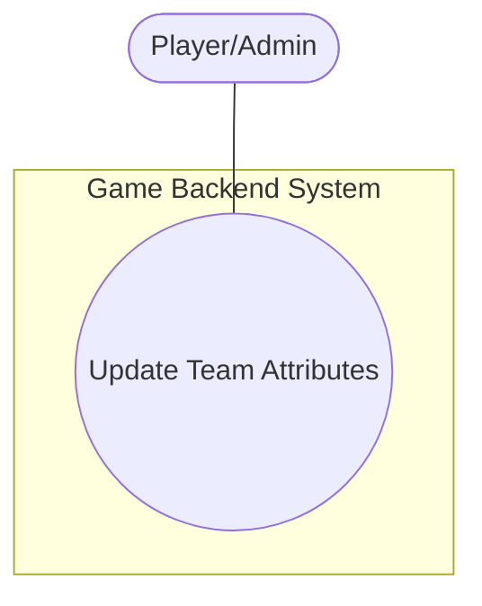

---

## UC-15: Read Available Drivers

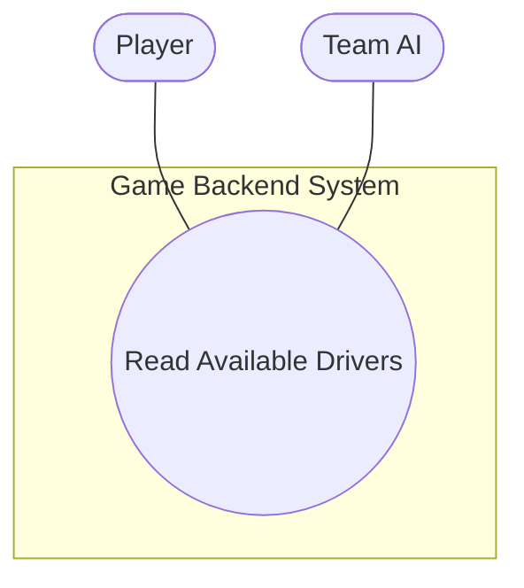

---

## UC-16: Update Driver Contract

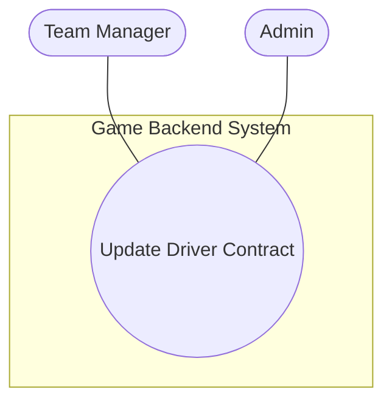

---

## UC-17: Read Available Staff

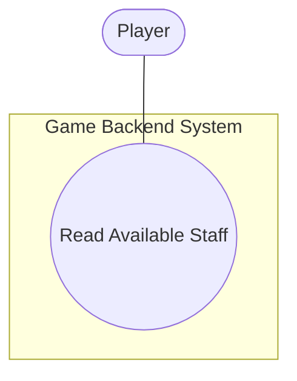

---

## UC-18: Update Staff Contract

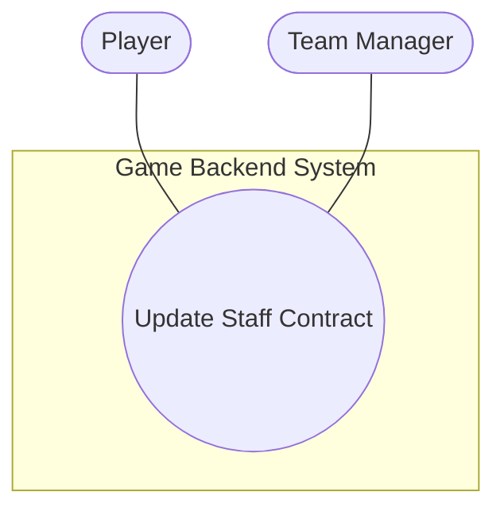

---

## UC-19: Update Driver Skills/Age

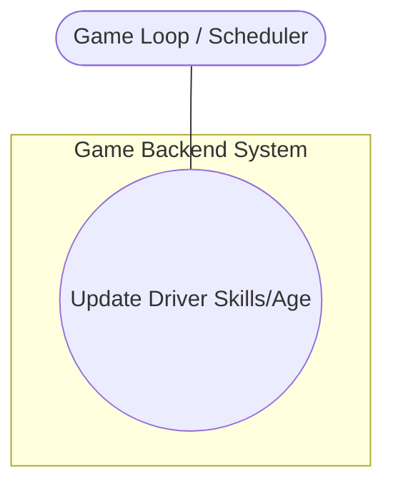

---

## UC-20: Update Team Budget

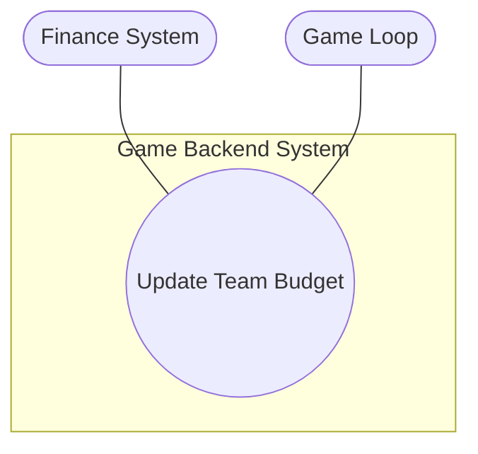

---

## UC-21: Create New Driver (rookie generation)

```mermaid
graph TB
  Admin([Admin/System])
  subgraph "Game Backend System"
    UC((Create New Driver))
  end
  Admin --- UC
```

---

## UC-22: Create New Staff Member (staff generation)

```mermaid
graph TB
  Admin([Admin/System])
  subgraph "Game Backend System"
    UC((Create New Staff Member))
  end
  Admin --- UC
```

---

## UC-23: Delete Championship

```mermaid
graph TB
  Admin([Admin])
  subgraph "Game Backend System"
    UC((Delete Championship))
  end
  Admin --- UC
```

---

## UC-24: Create Custom Track

```mermaid
graph TB
  Designer([Designer/Admin])
  subgraph "Game Backend System"
    UC((Create Custom Track))
  end
  Designer --- UC
```

---

## UC-25: Update Track Characteristics

```mermaid
graph TB
  Admin([Admin])
  subgraph "Game Backend System"
    UC((Update Track Characteristics))
  end
  Admin --- UC
```

---

## UC-26: Delete Track

```mermaid
graph TB
  Admin([Admin])
  subgraph "Game Backend System"
    UC((Delete Track))
  end
  Admin --- UC
```

---

## UC-27: Read Staff Performance Modifiers

```mermaid
graph TB
  Sim([Simulation Service])
  subgraph "Game Backend System"
    UC((Read Staff Performance Modifiers))
  end
  Sim --- UC
```

---

## UC-28: Update Driver Appearance

```mermaid
graph TB
  Player([Player])
  subgraph "Game Backend System"
    UC((Update Driver Appearance))
  end
  Player --- UC
```

---

## UC-29: Update Team Branding

```mermaid
graph TB
  Player([Player/Admin])
  subgraph "Game Backend System"
    UC((Update Team Branding))
  end
  Player --- UC
```

---

````
